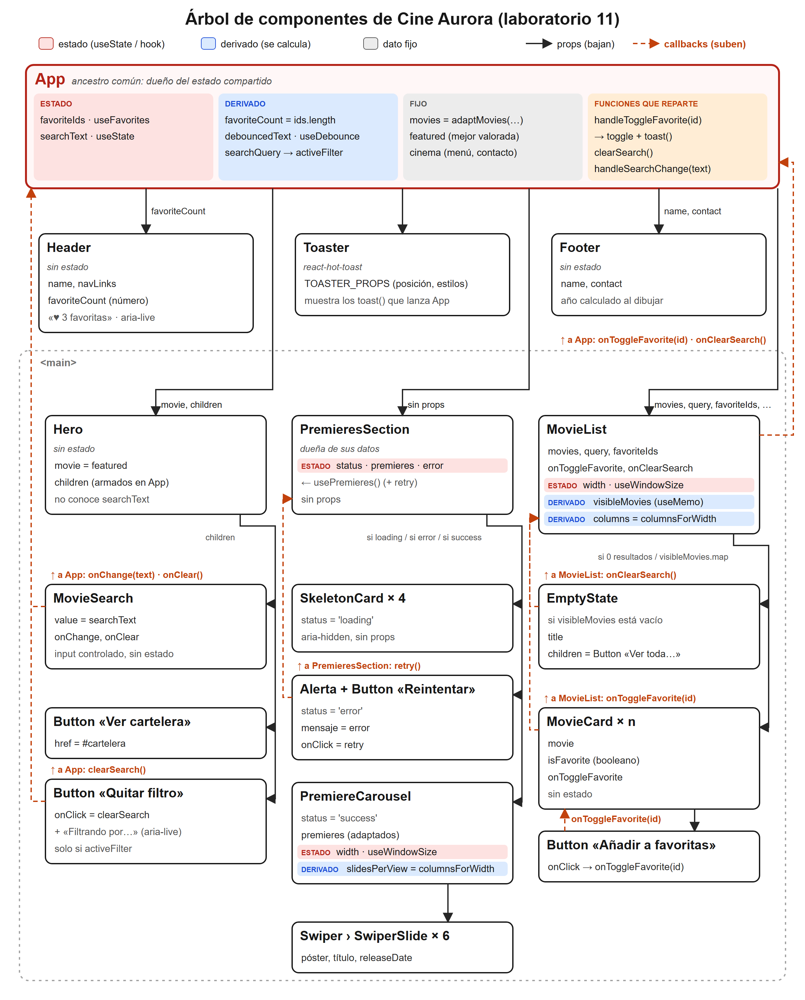
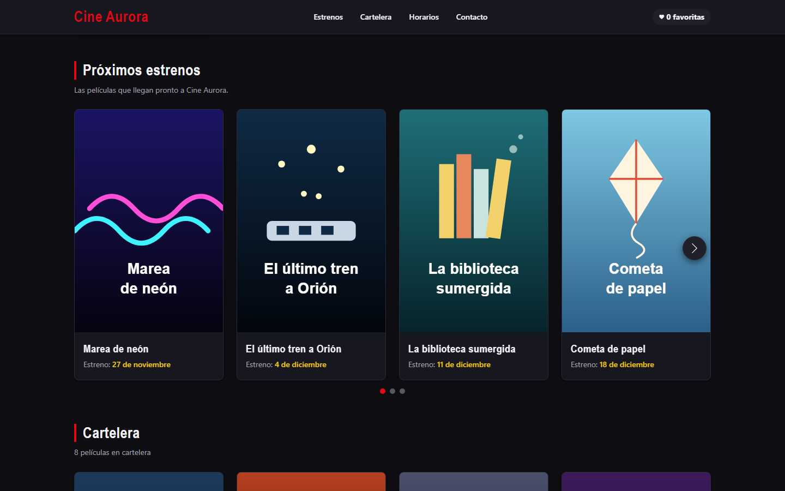
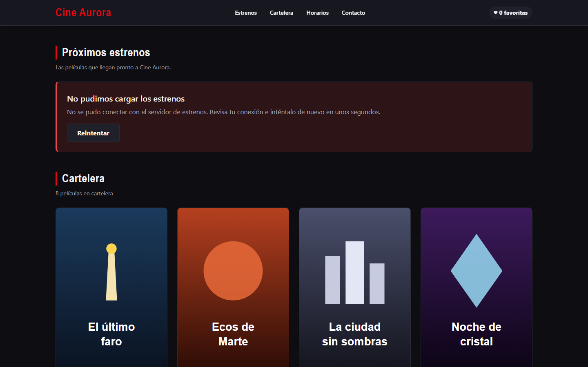
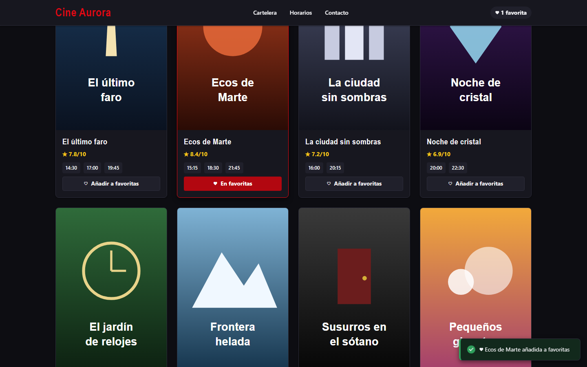
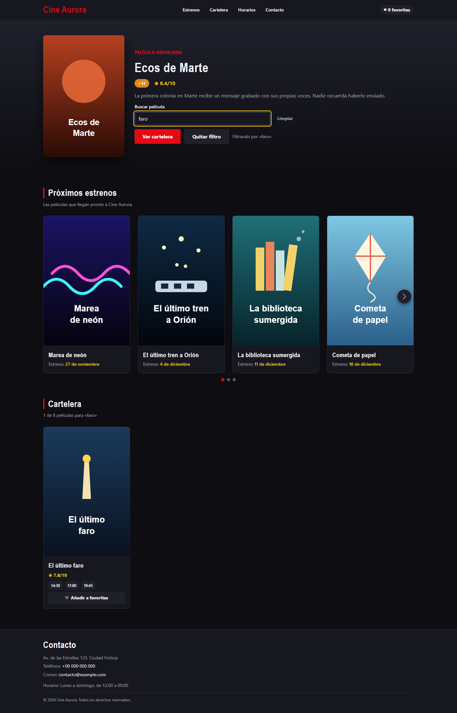
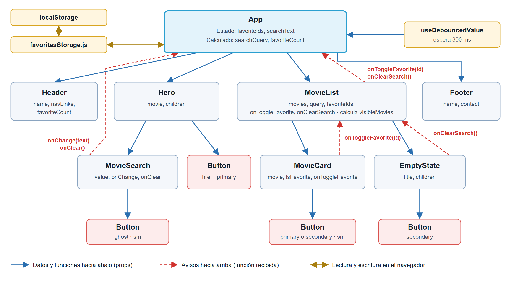

# Lab11: Comunicación entre componentes, hooks propios y bibliotecas de interfaz

Laboratorio 11 de Desarrollo de Aplicaciones Empresariales (DAE). Continúa la cartelera **Cine Aurora** del laboratorio 10 (su documentación y la de los laboratorios anteriores siguen más abajo, sin cambios) y la amplía en `frontend/` con estado elevado al ancestro común, cuatro hooks propios, avisos emergentes, un carrusel de estrenos y estados de carga y error. El backend Django del laboratorio 08 sigue en la raíz sin cambios.

**Integrantes:** Alonso Abad Mejia y Farid Chavez

## 🚀 Descripción

- **⭐ Favoritas en el ancestro común:** `favoriteIds` vive en `App` (hook `useFavorites`), porque lo usan dos ramas distintas: `Header` muestra el contador y `MovieCard` el botón. `Header` recibe solo el número, y el contador se calcula, no se guarda.
- **🔔 Avisos emergentes:** al marcar o desmarcar una favorita aparece un aviso con `react-hot-toast`. Lo lanza `App`, que es quien tiene el estado; `MovieCard` no conoce la biblioteca.
- **🎞️ Carrusel de estrenos:** sección «Próximos estrenos» con `Swiper` (flechas, puntos, teclado y textos accesibles en español). Mientras carga muestra esqueletos con la misma altura que el contenido real; si falla, un aviso con el botón «Reintentar».
- **🔎 Buscador sincronizado:** el texto vive en `App` y lo comparten tres hermanos. El buscador, el botón «Quitar filtro» del banner y el «Ver toda la cartelera» del estado vacío limpian el filtro con **la misma función**.
- **🧩 Patrón adaptador:** los datos llegan con forma de API (`poster_url`, `vote_average`, `release_date`…) y `adaptMovie` los convierte al modelo de la aplicación, para la cartelera y para los estrenos.
- **📐 Tarjetas por fila según el ancho:** 1, 2, 3 o 4 columnas en la cartelera y diapositivas en el carrusel, con `useWindowSize`.

## ▶️ Cómo ejecutarlo

```powershell
cd frontend
npm install
npm run dev      # http://localhost:5173/
npm test         # 104 pruebas con Vitest y Testing Library
npm run lint
npm run build
```

En desarrollo se pueden forzar los estados de los estrenos para verlos (en producción se ignora):

| URL | Estado |
|-----|--------|
| `http://localhost:5173/` | Carga de unos 1,2 s y luego el carrusel |
| `http://localhost:5173/?estrenos=lento` | Carga de 4 s (esqueletos) |
| `http://localhost:5173/?estrenos=error` | Error con el botón «Reintentar» |

## 🪝 Hooks propios

Todos viven en `frontend/src/hooks/`, empiezan por `use`, respetan las reglas de los hooks y tienen pruebas.

| Hook | Qué hace | Lo usan |
|------|----------|---------|
| `useDebounce(value, delayMs)` | Devuelve el valor solo cuando deja de cambiar durante `delayMs` | `App` (buscador, 300 ms) y `useWindowSize` (150 ms) |
| `useWindowSize()` | Tamaño de la ventana, actualizado al dejar de redimensionar | `MovieList` (columnas) y `PremiereCarousel` (diapositivas por vista) |
| `usePremieres()` | Petición de estrenos: `loading` / `success` / `error`, datos adaptados, cancelación y `retry` | `PremieresSection` |
| `useFavorites()` | Favoritas con `localStorage`, `toggleFavorite`, `isFavorite` y `favoriteCount` derivado | `App` |

## 📚 Bibliotecas de interfaz

| Biblioteca | Para qué | Cómo se integró |
|------------|----------|-----------------|
| [`react-hot-toast`](https://react-hot-toast.com/) 2.6 | Avisos al añadir (éxito) o quitar (info) una favorita | Un único `<Toaster />` en `App`, abajo a la derecha, con estilos hechos solo con los tokens de diseño. `App` llama a `toast()`; ningún componente de presentación la importa |
| [`Swiper`](https://swiperjs.com/react) 14 | Carrusel de próximos estrenos | `Swiper` y `SwiperSlide` con los módulos `Navigation`, `Pagination`, `Keyboard` y `A11y` y sus CSS. Los colores de Swiper apuntan a los tokens, y los textos de accesibilidad están en español |

## 🌳 Árbol de componentes



Estado (rojo), datos derivados (azul) y fijos (gris) de cada componente; las props bajan (flechas negras) y los callbacks suben (flechas naranjas discontinuas). La explicación completa, con la tabla de cada nivel y por qué el contador no puede vivir en `Header`, está en el [paso 11 del entregable](frontend/docs/ENTREGABLE_LAB11.md#paso-11-árbol-de-componentes-y-estado-elevado).

## 🌿 Rama de trabajo y Pull Request

- Todo el laboratorio se desarrolló en la rama **`lab11`**, sin commits directos en `main`.
- Al terminar, `lab11` se fusiona en `main` con un **Pull Request**, cuya descripción está en [frontend/docs/PR_LAB11.md](frontend/docs/PR_LAB11.md).

## 📦 Commits del laboratorio 11

| Paso | Commit |
|------|--------|
| 1 | `ce805d2` Configuración del laboratorio 11: CLAUDE.md, dependencias y entregable |
| 2 | `ded89cf` Paso 2: tipografía y utilidades nuevas, y script de capturas |
| 3 | `1f256b1` Paso 3: adaptador de películas y cartelera pasada por adaptMovies |
| 4 | `5f47926` Paso 4: aviso emergente al marcar y desmarcar favoritas con react-hot-toast |
| 5 | `3932982` Paso 5: hook propio useDebounce en el buscador |
| 6 | `9a8cd87` Paso 6: hook propio useWindowSize para las tarjetas por fila |
| 7 | `ab02631` Paso 7: hook usePremieres con estados de carga, datos y error |
| 8 | `8bd4d76` Paso 8: esqueleto de carga y carrusel de estrenos con Swiper |
| 9 | `f66b4c7` Paso 9: favoritas en el ancestro común con useFavorites y contador en la cabecera |
| 10 | `7dbf6ba` Paso 10: botón del banner que limpia el filtro con buscador y listado sincronizados |
| 11 | `84c2d62` Paso 11: árbol de componentes y explicación del estado elevado |
| 12 | Paso 12: README, cierre del entregable y descripción del Pull Request |

## 📸 Evidencias

- [Entregable del laboratorio 11](frontend/docs/ENTREGABLE_LAB11.md): resumen, qué se hizo en cada paso, el código explicado, las pruebas, el uso de IA y las conclusiones.
- [Capturas y salidas](Evidencias_lab11/): 35 evidencias numeradas por paso, tomadas con `scripts/capture.mjs` (Playwright) salvo las capturas 01, 02 y 33.

| Carrusel de estrenos | Error con «Reintentar» |
|----------------------|------------------------|
|  |  |
| **Aviso al añadir una favorita** | **Filtro activo en el banner** |
|  |  |

---

# Lab10: Componentes y eventos en la cartelera con React

Laboratorio 10 de Desarrollo de Aplicaciones Empresariales (DAE). Continúa el laboratorio 09 sobre la cartelera **Cine Aurora**, cuya documentación se conserva más abajo, y añade componentes reutilizables, estado y eventos en `frontend/`. El backend Django del laboratorio 08 sigue en la raíz sin cambios.

**Integrantes:** Alonso Abad Mejia y Farid Chavez

## Qué añade este laboratorio

- **`Button`:** un solo componente para todos los botones. Recibe el contenido por `children`, el aspecto por `variant` y `size`, y se convierte en enlace si recibe `href`.
- **Favoritas:** el estado vive en `App`. `MovieCard` avisa con la función que recibe y `Header` muestra el contador.
- **`MovieSearch`:** entrada controlada integrada en el banner, junto a la llamada a la acción.
- **Retardo:** `useDebouncedValue` aplica la búsqueda 300 ms después de la última tecla.
- **Filtrado y `EmptyState`:** `MovieList` filtra sin distinguir mayúsculas ni tildes y muestra un estado vacío si nada coincide.
- **Persistencia:** las favoritas se guardan en `localStorage` y se recuperan al cargar.

## Puesta en marcha

```powershell
cd frontend
npm install
npm run dev      # http://localhost:5173/
npm test         # 26 pruebas con Vitest y Testing Library
npm run lint
npm run build
```

## Documentación

- [Entregable del laboratorio 10](frontend/docs/ENTREGABLE_LAB10.md): dónde vive cada dato, qué componentes son reutilizables y por qué, medición del retardo y casos de prueba.
- [Capturas del sistema](Evidencias_lab10/).



---

# Lab09: Cartelera de Cine con React + Vite

Este repositorio contiene el desarrollo del proyecto Lab 09 de Desarrollo de Aplicaciones Empresariales (DAE), enfocado en la construcción de una interfaz web de cartelera de cine con **React** y **Vite**. Es una continuación acumulativa del Lab 08: conserva en la raíz el backend Django de la API de cuestionarios (documentado en el repositorio [Lab08-Django](https://github.com/faridchz16/Lab08-Django)), y añade en la carpeta `frontend/` la aplicación React de este laboratorio.

## 🚀 Descripción General del Proyecto

La aplicación es la cartelera del cine ficticio **"Cine Aurora"**. Muestra:
- una cabecera con navegación;
- un banner con la película mejor valorada;
- una rejilla con las 8 películas en cartelera (póster, valoración y horarios);
- un pie de página con los datos de contacto.

Los datos son estáticos (`src/data/movies.js`) y los pósters son SVG propios. El proyecto aborda cuatro ejes principales:

1. **Vite como herramienta de desarrollo:** Proyecto creado con la plantilla `react` de Vite, servidor de desarrollo con recarga en caliente (HMR), compilación de producción en `dist/` (excluida de Git) y análisis estático con ESLint.
2. **Componentes funcionales con JSX:** Cinco componentes en PascalCase. Cada uno vive en su carpeta con su `.jsx` y su `.css`, y usa HTML semántico (`header`, `nav`, `main`, `section`, `article`, `footer`), `className` y `alt` en todas las imágenes.
3. **Props de padre a hijos:** `App` es el único componente que importa los datos y los reparte por props. `Hero` y `MovieCard` reciben la película completa por props (`movie`) y desestructuran dentro solo los campos que usan. Ningún hijo tiene estado ni hooks: son componentes de presentación.
4. **Listas con `map` y `key`:** `MovieList` recorre la cartelera con `movies.map(...)` y asigna a cada `MovieCard` una `key={movie.id}` estable y única. `Header` y `MovieCard` hacen lo mismo con los enlaces (`link.id`) y los horarios.

## 🔗 Enlaces de Acceso Local (Desarrollo)

Una vez ejecutado el servidor de desarrollo (`npm run dev` dentro de `frontend/`), puedes acceder a:
- **Cartelera (inicio):** http://localhost:5173/
- **Sección Cartelera:** http://localhost:5173/#cartelera
- **Horarios:** http://localhost:5173/#horarios
- **Contacto:** http://localhost:5173/#contacto
- **Vista previa de producción (`npm run preview`):** http://localhost:4173/

## 📋 Resumen de Implementación y Puesta en Marcha

1. **Verificación del Entorno:**
   ```powershell
   node --version                  # probado con v24.15.0
   npm --version
   ```

2. **Instalación y Servidor de Desarrollo:**
   ```powershell
   cd frontend
   npm install
   npm run dev                     # Deja corriendo en una terminal → http://localhost:5173
   ```

3. **Compilación de Producción:**
   ```powershell
   npm run build                   # Genera frontend/dist/ (ignorada por Git)
   npm run preview                 # Sirve la compilación en http://localhost:4173
   ```

4. **Análisis Estático:**
   ```powershell
   npm run lint                    # ESLint sin errores ni avisos
   ```

**Dependencias:** `react` y `react-dom` 19.3.1, `vite` 8.3.6 y `@vitejs/plugin-react` 6.2.1. Para el desarrollo, `eslint` 10.14.0 con `eslint-plugin-react-hooks` y `eslint-plugin-react-refresh`. No se añadió ninguna dependencia a la plantilla de Vite.

## 🗂️ Estructura del Proyecto

```
frontend/
├── index.html                # lang="es", título "Cartelera de cine" y <div id="root">
├── public/
│   └── posters/              # 8 pósters SVG servidos tal cual (/posters/<slug>.svg)
├── docs/
│   └── ENTREGABLE.md         # Registro detallado de cada paso del laboratorio
└── src/
    ├── main.jsx              # Punto de entrada: importa global.css y monta <App /> en StrictMode
    ├── App.jsx               # Compone la página y reparte los datos por props
    ├── components/           # Una carpeta por componente: Componente.jsx + Componente.css
    │   ├── Header/
    │   ├── Hero/
    │   ├── MovieList/
    │   ├── MovieCard/
    │   └── Footer/
    ├── data/
    │   └── movies.js         # Exporta `movies` (8 películas) y `cinema` (nombre, navegación, contacto)
    └── styles/
        ├── variables.css     # Tokens: colores, tipografía, espaciado, radios y sombras
        └── global.css        # Estilos base, utilidades .container y .visually-hidden
```

- **`components/`:** cada componente tiene juntos su lógica y sus estilos, así que se puede mover o borrar sin dejar restos.
- **`data/`:** separa los datos de la presentación. Si los datos vienen de una API (por ejemplo, el backend del Lab 08), solo cambia esta capa.
- **`styles/`:** reúne lo global. Los CSS de los componentes solo usan las variables de `variables.css`.
- **`public/posters/`:** Vite sirve esta carpeta en la raíz del sitio, así que en los datos la imagen es una ruta de texto, como la URL que devolvería una API.

## 🧩 Componentes del Sistema

Cada película de `movies.js` tiene `id`, `title`, `image`, `synopsis`, `classification` (APT, +14, +18), `rating` (de 0 a 10) y `showtimes`.

- **`Header`** (`name`, `navLinks`): `<header>` fijo con el nombre del cine como `<h1>` y un `<nav>` con los enlaces a Cartelera, Horarios y Contacto.
- **`Hero`** (`movie`, del que usa `title`, `image`, `synopsis`, `classification` y `rating`): `<section>` con la película destacada, que `App` elige como la de mayor valoración. Muestra el póster, el título (`<h2>`), la insignia de clasificación con su color, la valoración `★ x/10` y la sinopsis.
- **`MovieList`** (`movies`): `<section id="cartelera">` con el título "Cartelera" y una rejilla responsiva (`id="horarios"`). Recorre las películas con `map` y pasa a cada `MovieCard` su película: `<MovieCard key={movie.id} movie={movie} />`.
- **`MovieCard`** (`movie`, del que usa `title`, `image`, `rating` y `showtimes`): `<article>` con el póster (`alt="Póster de …"`, carga diferida), el título (`<h3>`), la valoración y la lista de horarios con `<time>`.
- **`Footer`** (`name`, `contact`): `<footer id="contacto">` con la dirección (`<address>`), un enlace `tel:`, un enlace `mailto:`, el horario y el copyright con el año actual.

**Recorte de la pantalla en componentes:**

```
┌──────────────────────────────────────────────────────────────────┐
│ <Header>                  props: name, navLinks                  │
│  Cine Aurora (h1)           [Cartelera] [Horarios] [Contacto]    │ ← <header> + <nav>
├──────────────────────────────────────────────────────────────────┤
│ <main>                                                           │
│ ┌──────────────────────────────────────────────────────────────┐ │
│ │ <Hero>   props: movie  (película destacada; usa title,       │ │
│ │          image, synopsis, classification, rating)            │ │ ← <section>
│ │  ┌────────┐  Película destacada                              │ │
│ │  │ póster │  Ecos de Marte (h2)                              │ │
│ │  │        │  [+14]  ★ 8.4/10                                 │ │
│ │  └────────┘  Sinopsis…                                       │ │
│ └──────────────────────────────────────────────────────────────┘ │
│ ┌──────────────────────────────────────────────────────────────┐ │
│ │ <MovieList>   props: movies        id="cartelera"            │ │ ← <section>
│ │  Cartelera (h2)                                              │ │
│ │  ┌─────────────┐ ┌─────────────┐ ┌─────────────┐   id=       │ │
│ │  │ <MovieCard> │ │ <MovieCard> │ │ <MovieCard> │ "horarios"  │ │
│ │  │  póster     │ │  póster     │ │  póster     │   …         │ │ ← <article>
│ │  │  título(h3) │ │  título(h3) │ │  título(h3) │   (8 en     │ │   × 8, con
│ │  │  ★ 7.8/10   │ │  ★ 8.4/10   │ │  ★ 7.2/10   │   total)    │ │   key={movie.id}
│ │  │  14:30 17:00│ │  15:15 …    │ │  16:00 …    │             │ │
│ │  └─────────────┘ └─────────────┘ └─────────────┘             │ │
│ │  MovieCard props: movie (usa title, image, rating, showtimes)│ │
│ └──────────────────────────────────────────────────────────────┘ │
├──────────────────────────────────────────────────────────────────┤
│ <Footer>   props: name, contact          id="contacto"           │ ← <footer>
│  Contacto (h2) · dirección · teléfono · correo (<address>)       │
│  Horario · © 2026 Cine Aurora                                    │
└──────────────────────────────────────────────────────────────────┘
```

Flujo de datos: `movies.js` → `App` → props → componentes. Ningún componente importa los datos ni tiene estado.

## 🐞 Errores Típicos Registrados

Cada error se provocó a propósito, sin commit, y se revirtió después de la captura:

1. **`class` en lugar de `className` (aviso en consola):**
   - *Cambio:* en `MovieCard.jsx:6`, `<article className="movie-card">` → `<article class="movie-card">`.
   - *Mensaje:*
     ```
     Invalid DOM property `class`. Did you mean `className`?
     ```
   - *Explicación:* JSX se transforma en JavaScript y los atributos son propiedades de un objeto. En el DOM la propiedad se llama `className`, porque `class` es una palabra reservada de JavaScript. El código compila. React lo informa en la consola solo en modo desarrollo (en rojo, porque usa `console.error`), pero la página se sigue mostrando.
   - *Captura:*

     

2. **Dos nodos raíz sin fragmento (error de compilación):**
   - *Cambio:* en `Footer.jsx` el párrafo del copyright quedó fuera de `</footer>`, y el `return` devolvía dos elementos hermanos.
   - *Mensaje* (plugin `vite:oxc`, en la terminal y en el overlay del navegador):
     ```
     [plugin:vite:oxc] Transform failed with 1 error:
     [PARSE_ERROR] Unexpected token. Did you mean `{'}'}` or `&rbrace;`?
         ╭─[ src/components/Footer/Footer.jsx:30:1 ]
      30 │ }
     ```
   - *Explicación:*
     - **Error de compilación:** cada elemento JSX es una sola expresión y un `return` solo puede devolver un valor. Si el JSX no es sintaxis válida, el compilador falla antes de ejecutar nada, Vite responde con un 500 al pedir `Footer.jsx` y la aplicación no se actualiza.
     - **Compilador oxc:** Vite 8 transforma el JSX con **oxc** (plugin `vite:oxc`) en lugar de esbuild o Babel. Su parser informa del primer *token* inesperado, y por eso el mensaje difiere del clásico "Adjacent JSX elements must be wrapped in an enclosing tag".
     - **Este mensaje en concreto:** el cambio se guardó en dos escrituras, y Vite recompiló entre ellas, cuando `<footer>` y `<div>` aún estaban abiertos. oxc tomó `)` como texto JSX y no aceptó la `}` suelta de la línea 30.
     - **Estado final:** con los dos nodos raíz completos, oxc da el mensaje específico (`Adjacent JSX elements must be wrapped in an enclosing tag`, en `Footer.jsx:31:5`), como se comprobó con `npm run build`.
     - **Solución:** envolver los elementos en un fragmento `<>...</>`.
   - *Capturas:*

     

     

3. **`map` sin `key` (aviso de listas):**
   - *Cambio:* en `MovieList.jsx` se quitó `key={movie.id}` del `<MovieCard>` generado en `movies.map(...)`.
   - *Mensaje* (`MovieList.jsx:15`):
     ```
     Each child in a list should have a unique "key" prop. Check the render method of `MovieList`.
     ```
   - *Explicación:* React usa la `key` para identificar cada elemento entre renders y decidir qué crear, mover o eliminar (reconciliación). Sin ella solo se guía por la posición. La página se ve bien, pero React avisa porque reordenar o filtrar la lista podría reutilizar mal los nodos. La `key` debe ser estable y única (`movie.id`), no el índice.
   - *Captura:*

     

## 🤖 Agentes Utilizados en Claude Code

Durante el desarrollo de este laboratorio se configuraron subagentes especializados en `.claude/agents/`. Las reglas del proyecto (componentes funcionales en PascalCase, una carpeta por componente, props sin estado ni hooks, código en inglés y un commit por tarea en español) están en `CLAUDE.md`:
- **react-dev:** Especializado en escribir componentes funcionales y sus estilos dentro de `frontend/`. Tiene permisos de lectura, escritura y ejecución de comandos para compilar y pasar el lint.
- **ui-reviewer:** Revisor de **solo lectura** (`Read`, `Glob`, `Grep`). Comprueba que cada componente tenga una sola responsabilidad, que las props lleven solo lo necesario, que no haya avisos de React y que las imágenes tengan `alt`. En la revisión del paso 10 encontró 0 errores, 5 avisos (clases CSS sin regla) y 4 sugerencias. Se aplicaron los avisos y 3 de las sugerencias.

**Relación con los subagentes de opencode del Lab 08** (`.opencode/agent/`):
- **Mismo formato:** un archivo Markdown por agente, con *front matter* y un *prompt* de sistema.
- **`react-dev` y `django-dev`:** `react-dev` cumple en el frontend el papel que `django-dev` cumplía en el backend: el agente que construye el código.
- **`ui-reviewer` y `cli-gateway`:** `cli-gateway` aplicaba una frontera de seguridad sobre lo que podía hacer el agente. `ui-reviewer` lleva esa idea a la revisión: separa quien escribe de quien revisa y limita sus herramientas para que no pueda modificar nada.
- **Permisos:** opencode los declara con `permission:`, mientras que Claude Code restringe las herramientas con `tools:`.

## 📦 Estructura de Commits del Repositorio

El historial del Lab 09 parte del último commit del Lab 08 (`dbd0cd2`) y está organizado en commits atómicos documentados en español:
- *(último)* - Documentación README.md del laboratorio 09
- `828444b` - Documentación del laboratorio 09 en los README y conclusiones del entregable
- `3a05a81` - Registro de los tres errores típicos de JSX
- `5352a4b` - Composición de la cartelera en App y revisión
- `11a70b3` - Corrección de la numeración repetida de pasos en el entregable
- `b643b61` - Componente MovieList: rejilla de la cartelera con una tarjeta por película
- `f3c828b` - Componente MovieCard: tarjeta de película con póster, valoración y horarios
- `cc581d5` - Componente Hero: banner de la película mejor valorada
- `cf923a4` - Componente Footer: pie de página con los datos de contacto del cine
- `be1505e` - Componente Header: encabezado con el nombre del cine y la navegación
- `d6946bd` - Documentación de la estructura de carpetas y los datos en el entregable
- `13da241` - Creación de los datos de películas y del cine con pósters SVG
- `5e669c3` - Organización de src/ en carpetas y arquitectura de CSS
- `95de66d` - Registro del traslado a Lab09-React en el entregable
- `1bbda23` - Actualización de CLAUDE.md: el repositorio pasa a ser Lab09-React
- `f7d9c0f` - Documentación del entregable del laboratorio 09
- `74e6105` - Limpieza del andamiaje de la plantilla
- `0cb7788` - Creación de los subagentes react-dev y ui-reviewer en .claude/agents/
- `c7c3b61` - Creación de CLAUDE.md con la descripción del repositorio y las reglas del frontend
- `f1a9673` - Creación del proyecto React con Vite en frontend/

## 📸 Capturas y Evidencias

A continuación se muestran las principales evidencias del desarrollo, el funcionamiento y las pruebas del proyecto, almacenadas en la carpeta `Evidencias_lab09/`. Las capturas 08 a 10 se tomaron automáticamente con Playwright (ejecutado con `npx`, sin añadirlo como dependencia):

1. **Creación del Proyecto con Vite:**
   Clonado del repositorio del Lab 08, verificación de Node (`v24.15.0`) y ejecución de `npm create vite@latest frontend`.
   

2. **Estructura de Carpetas:**
   Explorador con `frontend/src/` organizado en `components/`, `data/` (`movies.js`) y `styles/` (`global.css`, `variables.css`), junto al backend del Lab 08.
   

3. **Cartelera en el Navegador:**
   Header con navegación, Hero con la película destacada ("Ecos de Marte", +14, ★ 8.4/10) y la primera fila de la rejilla de la cartelera.
   

4. **Error 1 – `class` en lugar de `className`:**
   Consola de DevTools con el aviso `` Invalid DOM property `class`. Did you mean `className`? `` en `MovieCard.jsx:6`; la página se sigue mostrando.
   

5. **Error 2 – Dos nodos raíz (navegador):**
   Overlay de Vite `[plugin:vite:oxc] Transform failed with 1 error` con el `PARSE_ERROR` en `Footer.jsx:30:1`, y la consola con el 500 al cargar `Footer.jsx`.
   

6. **Error 2 – Dos nodos raíz (terminal):**
   Servidor de desarrollo con `Internal server error: Transform failed with 1 error` y el mismo `PARSE_ERROR` del plugin `vite:oxc`.
   

7. **Error 3 – `map` sin `key`:**
   Consola con `` Each child in a list should have a unique "key" prop. Check the render method of `MovieList`. `` en `MovieList.jsx:15`.
   

8. **Cartelera, Página Completa (escritorio 1440×900):**
   Toda la página: Header, Hero, las 8 películas en una rejilla de 4 columnas y el Footer.
   

9. **Footer:**
   Captura solo del elemento `<footer id="contacto">`, con la dirección, el teléfono, el correo, el horario y el copyright.
   

10. **Vista Móvil (390×844, página completa):**
    La rejilla pasa a una sola columna y la navegación se adapta al ancho del móvil.
    
