# Entregable – Laboratorio 11: Comunicación entre componentes, hooks propios y bibliotecas de interfaz

**Integrantes:** Alonso Abad Mejia y Farid Chavez · **Curso:** Desarrollo de Aplicaciones Empresariales · **Sección:** 4-C24-A

## Paso 1: Preparación del proyecto

- **Punto de partida:** se partió del laboratorio 10
  ([Lab10-React](https://github.com/jordanabad797-pixel/Lab10-React)) en un repositorio nuevo,
  [Lab11-React](https://github.com/faridchz16/Lab11-React), que conserva todo su historial.
- **Rama de trabajo:** `lab11`. Todos los commits del laboratorio van en esta rama y al final se
  fusionan en `main` mediante un Pull Request. No se hacen commits directamente en `main`.
- **`CLAUDE.md`:** actualizado para el laboratorio 11 con las reglas nuevas (hooks propios en
  `src/hooks/`, estado en el ancestro común, avisos con `react-hot-toast`, carrusel con `swiper`).
- **Dependencias añadidas** en `frontend/`:

  | Paquete | Versión | Uso |
  |---------|---------|-----|
  | `react-hot-toast` | ^2.6.1 | Avisos emergentes |
  | `swiper` | ^14.4.0 | Carrusel |

- **Línea base** (con las dependencias ya instaladas, antes de cambiar código):

  | Comando | Resultado |
  |---------|-----------|
  | `npm test` | 7 archivos, 26 pruebas superadas |
  | `npm run lint` | Sin errores ni avisos |
  | `npm run build` | Correcto: 37 módulos, JS 228.85 kB (71.89 kB gzip), CSS 9.04 kB (2.28 kB gzip) |

  `npm audit` informa de 4 vulnerabilidades moderadas en `minimatch`, que llega a través de las
  herramientas de desarrollo (ESLint). No afectan a la compilación publicada ni vienen de los
  paquetes nuevos.

- **Evidencias:** las capturas del laboratorio se guardan en `Evidencias_lab11/`.

| Captura | Explicación |
|---------|-------------|
| [01_rama_lab11.png](../../Evidencias_lab11/01_rama_lab11.png) | Se apunta `origin` al repositorio nuevo, se sube `main`, se crea y se sube la rama `lab11`, y `git branch` confirma que es la rama activa. |
| [02_lab10_funcionando.png](../../Evidencias_lab11/02_lab10_funcionando.png) | La cartelera del laboratorio 10 en `localhost:5173` (cabecera con favoritas, banner con buscador y tarjetas) funciona como punto de partida. |

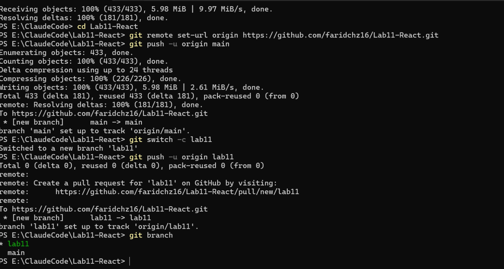
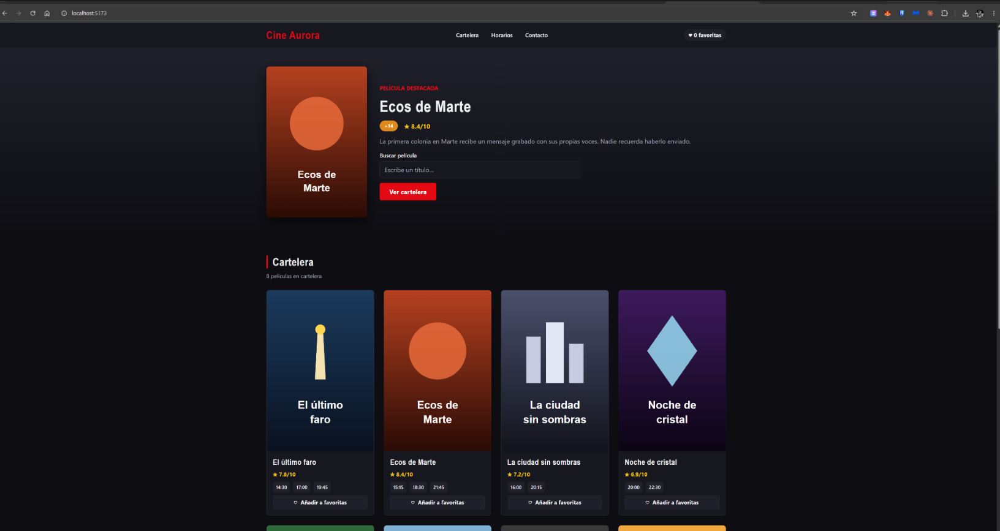

### Capturas automáticas

Las capturas desde el paso 2 se toman con `scripts/capture.mjs`, que usa Playwright por `npx`
sin añadirlo a `frontend/package.json`. Con el servidor de desarrollo en marcha abre
`http://localhost:5173`, puede hacer clics, escribir, esperar a un elemento (por ejemplo, un aviso
emergente), capturar la página completa, la parte visible o un selector en escritorio
(1440x900) o móvil (390x844), y guardar la consola en un `.txt`.

```bash
npx -y playwright@1.56.1 install chromium   # solo la primera vez
npx -y -p playwright@1.56.1 node scripts/capture.mjs --mobile --full --out Evidencias_lab11/04_paso2_movil.png
```

## Paso 2: Tipografía y utilidades nuevas

Se amplió la hoja base sin tocar ningún componente. Las utilidades reutilizan los tokens: no hay
colores escritos a mano en `global.css`.

### Tokens nuevos (`frontend/src/styles/variables.css`)

| Grupo | Tokens | Para qué se usará |
|-------|--------|-------------------|
| Escala tipográfica | `--font-size-3xl`; `--line-height-none`, `-snug`, `-relaxed`; `--line-height-xs` … `-3xl` (una por tamaño) | Que cada tamaño de texto lleve su altura de línea; títulos grandes del carrusel |
| Pesos | `--font-weight-semibold` | Títulos de tarjetas y avisos |
| Espaciado y maquetación | `--space-9`, `--section-space`, `--grid-gap`, `--grid-min-column` | La clase `.section` y la rejilla `.grid` |
| Avisos | `--color-success`, `--color-error`, `--color-info` y su fondo `-bg`; `--toast-text`, `--toast-bg`, `--toast-border`, `--toast-radius`; `--z-toast` | Estilo de los avisos de `react-hot-toast` (éxito, error, info) |
| Esqueleto de carga | `--skeleton-base`, `--skeleton-highlight`, `--skeleton-radius`, `--skeleton-duration` | El marcador que se ve mientras cargan los datos |
| Movimiento | `--transition-base` | Transiciones algo más lentas que `--transition-fast` (carrusel, avisos) |

### Utilidades nuevas (`frontend/src/styles/global.css`)

| Clase | Qué hace | Para qué se usará |
|-------|----------|-------------------|
| `.text-xs`, `.text-lg`, `.text-xl` | Tamaño de texto con su altura de línea (se suman a `.text-sm`) | Textos de apoyo, avisos y títulos |
| `.font-regular`, `.font-medium`, `.font-semibold`, `.font-bold` | Peso de la fuente | Énfasis sin crear CSS en cada componente |
| `.section` | Espaciado vertical uniforme (`--section-space`) | Secciones nuevas de la página, como el carrusel |
| `.grid` | Rejilla con `repeat(var(--columns, 1), …)`; el número de columnas se cambia desde fuera con `style={{ '--columns': n }}` | Paso 6: `useWindowSize` calculará `--columns` según el ancho |
| `.skeleton`, `.skeleton-text` | Bloque gris con un brillo que se desplaza (`@keyframes shimmer`) | Estado de carga. Con `prefers-reduced-motion: reduce` la animación se desactiva y queda un bloque fijo |

### Comprobación visual

Se tomaron capturas de la página completa antes y después del cambio con los mismos parámetros.
Los archivos son **idénticos byte a byte** (`cmp` sin diferencias): los componentes existentes se
ven igual, porque ninguna clase nueva coincide con las que ya usaban. La consola no muestra errores
ni avisos.

| Captura | Explicación |
|---------|-------------|
| [03_paso2_escritorio.png](../../Evidencias_lab11/03_paso2_escritorio.png) | Página completa a 1440x900 tras ampliar la hoja: cabecera, banner con buscador, las 8 tarjetas en 4 columnas y pie, igual que en el laboratorio 10. |
| [04_paso2_movil.png](../../Evidencias_lab11/04_paso2_movil.png) | Página completa a 390x844: cabecera compacta, tarjetas en una columna y sin desbordamiento horizontal. |

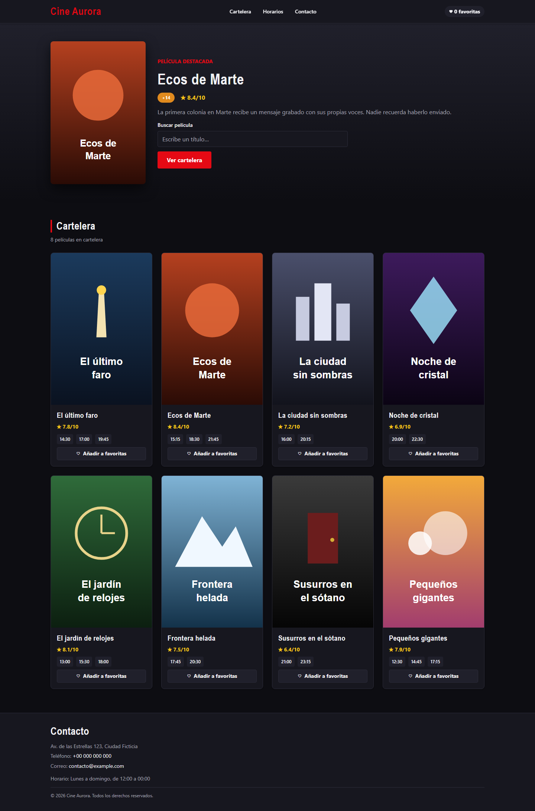
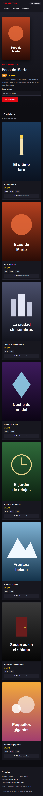

### Resultados

| Comando | Resultado |
|---------|-----------|
| `npm test` | 7 archivos, 26 pruebas superadas |
| `npm run lint` | Sin errores ni avisos |
| `npm run build` | Correcto. El CSS pasa de 9.04 kB a 11.10 kB (2.74 kB gzip); el JS no cambia (228.85 kB) |

### Observaciones

- En las primeras capturas completas, los carteles de las tarjetas que no se ven al abrir la
  página salían vacíos. Los carteles usan `loading="lazy"` y el navegador no los pedía porque la
  página nunca se desplazaba. Se corrigió en el script, no en la aplicación: con `--full` recorre
  la página, espera a que carguen las imágenes y vuelve arriba de forma instantánea. Si vuelve
  con `scroll-behavior: smooth`, la cabecera fija aparece a media página.

## Paso 3: Adaptador de películas

### Qué es el patrón adaptador

Un adaptador traduce los datos de una forma que no controlamos (la respuesta de una API) a la
forma que espera nuestra aplicación. Se coloca en la frontera: los datos entran por él una sola
vez y, a partir de ahí, la aplicación solo conoce su propio modelo. Si mañana la API cambia un
nombre o deja de enviar un campo, se corrige el adaptador y ningún componente se entera.

### Datos con forma de API

`frontend/src/data/movies.js` ahora exporta `apiMovies`: las mismas 8 películas con los mismos
valores, pero con los nombres en `snake_case` que usaría un servidor. Ya no se pinta
directamente: siempre pasa por `adaptMovies`. El objeto `cinema` (nombre, menú y contacto) no
cambió, porque no viene de la API de películas.

| Campo de la API | Campo de la app | Transformación |
|-----------------|-----------------|----------------|
| `id` | `id` | Se copia; `null` si falta |
| `title` | `title` | Texto sin espacios sobrantes; `'Sin título'` si falta o está vacío |
| `poster_url` | `image` | Texto; `null` si falta, para que React no ponga `src=""` y se vea el texto alternativo |
| `overview` | `synopsis` | Texto; `''` si falta |
| `certification` | `classification` | Texto; `'Sin clasificar'` si falta (`Hero` lo muestra con la insignia neutra) |
| `vote_average` | `rating` | Número en la escala 0-10; `0` si falta o no es un número; se limita a 0-10; acepta texto numérico (`'7.5'`) |
| `show_times` | `showtimes` | Lista sin entradas vacías; `[]` si falta o no es una lista |

### El código del adaptador

`frontend/src/utils/adaptMovie.js`:

```js
export function adaptMovie(apiMovie = {}) {
  const movie = apiMovie ?? {}
  return {
    id: movie.id ?? null,
    title: toText(movie.title, 'Sin título'),
    image: toText(movie.poster_url, null),
    synopsis: toText(movie.overview),
    classification: toText(movie.certification, UNKNOWN_CLASSIFICATION),
    rating: toRating(movie.vote_average),
    showtimes: toShowtimes(movie.show_times),
  }
}

export function adaptMovies(list) {
  return Array.isArray(list) ? list.map(adaptMovie) : []
}
```

- **`adaptMovie`** construye un objeto nuevo con los 7 campos de la app. Solo lee los campos que
  conoce, así que los campos extra de la API no se cuelan en la aplicación. `apiMovie ?? {}`
  evita que falle si llega `null` o `undefined`.
- **Tres funciones auxiliares** se encargan de los valores por defecto:
  - `toText` acepta solo texto no vacío y, si no, devuelve el valor por defecto.
  - `toRating` convierte a número, usa `0` si no es válido y lo mantiene entre 0 y 10.
  - `toShowtimes` devuelve `[]` si no recibe una lista y quita los horarios vacíos.
- **`adaptMovies`** aplica `adaptMovie` a toda la lista. Si la respuesta no es una lista, devuelve
  una cartelera vacía en lugar de romper el `.map` de `MovieList`.

En `App.jsx`, la cartelera se adapta una sola vez, fuera del componente, porque los datos son
estáticos:

```js
const movies = adaptMovies(apiMovies)
```

El adaptador se reutilizará en el paso 7 para los estrenos.

### Por qué los componentes no cambiaron

`Header`, `Hero`, `MovieList` y `MovieCard` reciben el mismo modelo
`{ id, title, image, synopsis, classification, rating, showtimes }` que antes. El cambio de forma
se queda en la frontera (`data/` → `adaptMovie` → `App`). Se comprobó con Node que
`adaptMovies(apiMovies)` es **idéntico** (`deepStrictEqual`) al arreglo `movies` del commit
anterior, y la captura de la página completa es idéntica byte a byte a la del paso 2.

### Pruebas

`frontend/src/utils/adaptMovie.test.js` añade 9 pruebas:

| Grupo | Qué comprueba |
|-------|---------------|
| Mapeo correcto | Cada campo de la API llega a su campo de la app, y el resultado solo tiene los 7 campos del modelo aunque la API envíe campos extra |
| Campos que faltan | Película con solo `id`; película `null` o `undefined`; valores inválidos (título en blanco, póster vacío, `vote_average: 'n/a'`, `show_times` que no es lista); valoración fuera de 0-10 o en texto; horarios vacíos |
| Lista completa | `adaptMovies(apiMovies)` devuelve las 8 películas, en orden y con todos sus valores; una respuesta que no es lista da `[]` |

### Evidencias

| Evidencia | Explicación |
|-----------|-------------|
| [05_paso3_cartelera_adaptada.png](../../Evidencias_lab11/05_paso3_cartelera_adaptada.png) | Página completa a 1440x900 con la cartelera pasando por `adaptMovies`: las 8 películas, la destacada (*Ecos de Marte*, 8.4) y las insignias se ven igual que antes. La consola no muestra errores ni avisos. |
| [06_paso3_tests.txt](../../Evidencias_lab11/06_paso3_tests.txt) | Salida detallada de las pruebas: 8 archivos y 35 pruebas superadas, 9 de ellas del adaptador. |


### Resultados

| Comando | Resultado |
|---------|-----------|
| `npm test` | 8 archivos, 35 pruebas superadas (26 anteriores + 9 del adaptador) |
| `npm run lint` | Sin errores ni avisos |
| `npm run build` | Correcto: 38 módulos, JS 229.51 kB (72.13 kB gzip) |

## Paso 4: Aviso emergente al marcar y desmarcar favoritas

### El flujo

```
MovieCard ──onToggleFavorite(id)──▶ MovieList ──▶ App.toggleFavorite(id)
                                                    ├─ wasFavorite = favoriteIds.includes(id)
                                                    ├─ setFavoriteIds(updater puro)
                                                    └─ toast.success(...) / toast(...)
                                                              │
                                                    <Toaster /> (montado una vez en App)
```

1. El usuario pulsa el botón de favorita de una tarjeta.
2. `MovieCard` llama a `onToggleFavorite(id)`, igual que en el laboratorio 10. No sabe nada más.
3. `App.toggleFavorite` comprueba si la película **ya era** favorita, actualiza el estado y lanza
   el aviso que corresponda.
4. El único `<Toaster />`, montado en `App` abajo a la derecha, lo muestra.

### Por qué la tarjeta no conoce la biblioteca

`MovieCard` es un componente de presentación: recibe `isFavorite` y avisa con
`onToggleFavorite`. Quien tiene el estado (`App`) es quien sabe si la película se añadió o se
quitó, así que es quien decide qué decir y cómo mostrarlo. Hay tres ventajas:

- **Se puede reutilizar:** la tarjeta sirve en cualquier lugar, también donde no haga falta aviso.
- **Se puede cambiar la biblioteca:** reemplazar `react-hot-toast` solo toca `App` y
  `utils/toastOptions.js`.
- **Las pruebas siguen igual:** `MovieCard.test.jsx` sigue pasando sin cambios.

Se comprobó con `grep` y con `git diff`:

```bash
$ grep -rn "react-hot-toast\|toast" frontend/src/components/
(sin resultados, código de salida 1)
$ git diff --quiet HEAD -- frontend/src/components/MovieCard && echo "MovieCard sin cambios"
MovieCard sin cambios
```

### El código explicado

`frontend/src/App.jsx`:

```js
function toggleFavorite(movieId) {
  const wasFavorite = favoriteIds.includes(movieId)
  const title = movies.find((movie) => movie.id === movieId)?.title ?? 'La película'

  setFavoriteIds((currentIds) =>
    currentIds.includes(movieId)
      ? currentIds.filter((id) => id !== movieId)
      : [...currentIds, movieId],
  )

  const toastId = `favorite-${movieId}`
  if (wasFavorite) {
    toast(`${title} quitada de favoritas`, { id: toastId })
  } else {
    toast.success(`♥ ${title} añadida a favoritas`, { id: toastId })
  }
}
```

- **`wasFavorite` se calcula antes de actualizar.** No hace falta esperar al nuevo estado: si ya
  estaba marcada, el clic la quita.
- **La función de actualización de `setFavoriteIds` sigue siendo pura:** solo calcula la lista
  nueva. El aviso se lanza **fuera** de ella, porque React puede ejecutar esa función dos veces
  (en `StrictMode` lo hace a propósito) y saldrían avisos duplicados.
- **El título** se busca en la cartelera ya adaptada (paso 3), porque la tarjeta solo envía el `id`.
- **`id: favorite-<id>`:** si se marca y desmarca la misma película seguido, el aviso nuevo
  reemplaza al anterior en vez de apilarse. Las películas distintas tienen avisos distintos.
- **Tipos de aviso:**
  - Añadir usa `toast.success` (éxito).
  - Quitar usa `toast()`, el tipo neutro (`blank`) de la biblioteca, que aquí tiene el estilo de
    info: `react-hot-toast` no trae un `toast.info`.

`frontend/src/utils/toastOptions.js` agrupa las props del `<Toaster />`:
`position: 'bottom-right'` y los estilos `success`, `error` y `blank`. Todos usan los tokens del
paso 2 mediante `var(--…)`:
- el fondo y el borde de color de cada tipo (`--color-success-bg`, `--color-info`, …);
- `--toast-text`, `--toast-radius`, `--shadow-md`;
- `--z-toast` para el contenedor.

No hay colores escritos a mano, y el aviso queda oscuro, como el resto de la página.
`App` lo monta con `<Toaster {...TOASTER_PROPS} />`.

### Pruebas

- **`App.test.jsx`** añade dos pruebas:
  - Al pulsar «Añadir a favoritas» aparece «♥ Ecos de Marte añadida a favoritas», dentro de un
    elemento `role="status"`. Al desmarcar aparece «Ecos de Marte quitada de favoritas» y el
    aviso anterior desaparece.
  - Dos películas distintas muestran dos avisos, cada uno con su título.
- **`MovieCard.test.jsx`** pasa sin cambios.
- **`src/test/setup.js`** se ajustó en dos puntos:
  - jsdom no tiene `window.matchMedia`, y `react-hot-toast` lo usa para comprobar
    `prefers-reduced-motion`, así que se añadió un sustituto **solo en las pruebas**.
  - El almacén de avisos es global, así que se vacía con `toast.remove()` después de cada prueba
    para que no pasen de una a otra.

### Evidencias

| Evidencia | Explicación |
|-----------|-------------|
| [07_paso4_aviso_anadida.png](../../Evidencias_lab11/07_paso4_aviso_anadida.png) | Tras pulsar «Añadir a favoritas» en *Ecos de Marte*: el aviso de éxito (verde) abajo a la derecha, el contador de la cabecera en **1 favorita** y la tarjeta marcada. |
| [08_paso4_aviso_quitada.png](../../Evidencias_lab11/08_paso4_aviso_quitada.png) | Tras desmarcarla: el aviso de info (azul) «Ecos de Marte quitada de favoritas», el contador vuelve a **0** y la tarjeta queda sin marcar. |
| [09_paso4_tests.txt](../../Evidencias_lab11/09_paso4_tests.txt) | Salida detallada de las pruebas: 37 superadas, incluidas las dos del aviso y las de `MovieCard` sin cambios. |

Las capturas se tomaron con `capture.mjs`: hace clic en el botón de la tarjeta y espera con
`--wait-text` a que aparezca el texto del aviso. No hizo falta tocar el código de la aplicación
para forzar el aviso. La consola no mostró errores ni avisos.

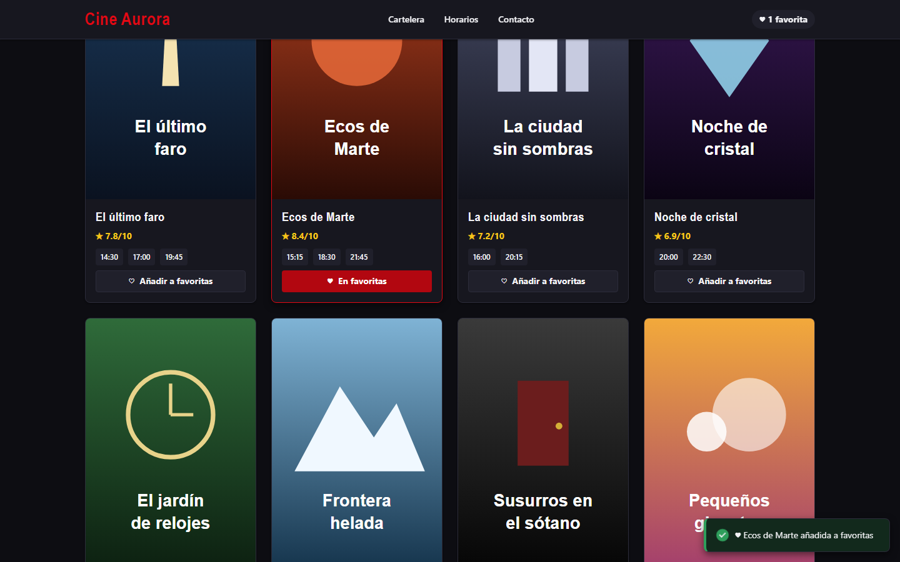
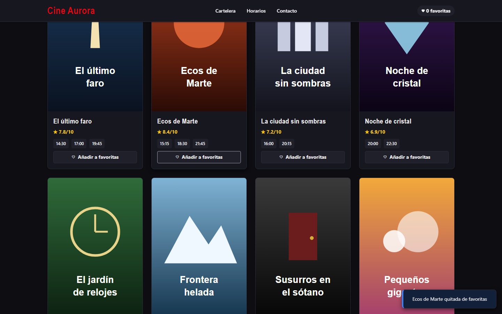

### Resultados

| Comando | Resultado |
|---------|-----------|
| `npm test` | 8 archivos, 37 pruebas superadas (35 anteriores + 2 del aviso) |
| `npm run lint` | Sin errores ni avisos |
| `npm run build` | Correcto: 41 módulos, JS 242.68 kB (77.01 kB gzip); `react-hot-toast` añade unos 13 kB (5 kB gzip) |

## Paso 5: Hook propio `useDebounce`

### Qué es el debounce

*Debounce* significa esperar a que algo **deje de cambiar** durante un tiempo antes de reaccionar.
Al escribir «faro» se producen cuatro cambios seguidos (`f`, `fa`, `far`, `faro`). Sin debounce,
la cartelera se filtraría cuatro veces. Con debounce de 300 ms, cada pulsación reinicia la espera
y la cartelera se filtra **una sola vez**, con `faro`, cuando el usuario hace una pausa.

### El código, línea por línea

`frontend/src/hooks/useDebounce.js`:

```js
import { useEffect, useState } from 'react'                       // 1

export function useDebounce(value, delayMs) {                     // 2
  const [debouncedValue, setDebouncedValue] = useState(value)     // 3

  useEffect(() => {                                               // 4
    const timerId = setTimeout(() => setDebouncedValue(value), delayMs) // 5
    return () => clearTimeout(timerId)                            // 6
  }, [value, delayMs])                                            // 7

  return debouncedValue                                           // 8
}
```

1. Importa los dos hooks de React que usa. Un hook propio no es más que una función que combina
   otros hooks.
2. El nombre empieza por `use`, así React (y la regla `react-hooks` de ESLint) lo trata como hook.
   Recibe el valor que cambia y la espera en milisegundos. Es genérico: sirve para texto, números
   u objetos.
3. Guarda el valor «calmado» en su propio estado. Empieza con el valor actual, así que el primer
   render no espera nada.
4. El efecto se ejecuta después de cada render en que cambió `value` o `delayMs`.
5. Programa la actualización para dentro de `delayMs`. Si nada lo cancela, el estado pasa a ser
   el último `value`.
6. **La limpieza.** React la ejecuta antes de volver a correr el efecto y al desmontar el
   componente. Cada cambio nuevo cancela el temporizador anterior, así que de una ráfaga solo
   sobrevive el último. Al desmontar no queda ningún temporizador pendiente que actualice un
   componente que ya no existe.
7. Dependencias: todo lo que el efecto lee de fuera (`value`, `delayMs`). Si cambia la espera, el
   temporizador también se reinicia.
8. Devuelve el valor con retardo. Quien llama decide qué hacer con él.

**Reglas de los hooks:**
- `useState` y `useEffect` se llaman siempre, en el mismo orden y en el nivel superior del hook.
  No hay condiciones, bucles ni funciones anidadas.
- `App` llama a `useDebounce` también en el nivel superior.
- `npm run lint` (con `eslint-plugin-react-hooks`) no da avisos.

### Uso en el buscador

`App.jsx` sigue aplicando el retardo, ahora con el hook nuevo:

```js
const debouncedText = useDebounce(searchText, SEARCH_DELAY_MS)  // 300 ms
// Emptying the box is not a typing burst: the full list comes back at once.
const searchQuery = searchText === '' ? '' : debouncedText
```

Se mantiene el comportamiento del Lab 10: al borrar el texto, o al pulsar «Limpiar» o «Ver toda
la cartelera», la lista completa vuelve **al instante**, sin esperar los 300 ms. Lo comprueban
las pruebas de `App.test.jsx` que ya existían: tras limpiar, esperan las 8 tarjetas enseguida,
sin `waitFor`.

### Diferencia con el Lab 10

| | Lab 10: `useDebouncedValue` | Lab 11: `useDebounce` |
|---|---|---|
| Nombre | `useDebouncedValue` | `useDebounce`, el que pide la guía |
| Lógica | `useState` + `useEffect` con `setTimeout` y `clearTimeout` | La misma, comentada línea a línea |
| Pruebas | 2: retardo y ráfaga | 5: valor inicial inmediato, retardo exacto, ráfaga con **una sola** actualización (se registra cada valor devuelto), cambio de espera y limpieza al desmontar |
| Uso | Solo el buscador | El buscador, y en el paso 6 también `useWindowSize` |

La lógica del Lab 10 ya era correcta, así que el cambio es de nombre, documentación y pruebas, no
de comportamiento. `useDebouncedValue.js` y su prueba se eliminaron, y `grep` no encuentra
ninguna referencia en `src/`. Git los registra como borrado + archivo nuevo, no como renombrado,
porque los comentarios y las pruebas nuevas cambian demasiado el contenido. El código anterior
sigue en el historial del laboratorio 10. Como prueba de que las pruebas nuevas sirven, se quitó temporalmente la línea 6 (la
limpieza): fallaron la de la ráfaga y la del desmontaje. Después se restauró.

> **Paso 6:** `useWindowSize` también usará `useDebounce`, para no recalcular las columnas en cada
> evento `resize`. Así el hook se usa en más de un sitio, como pide la guía («el hook se usa en
> más de un componente»).

### Evidencias

| Evidencia | Explicación |
|-----------|-------------|
| [10_paso5_busqueda_faro.png](../../Evidencias_lab11/10_paso5_busqueda_faro.png) | Página completa tras escribir «faro» letra a letra (120 ms por tecla): el buscador muestra `faro` y la cartelera, «1 de 8 películas para «faro»», con solo *El último faro*. |
| [11_paso5_consola.txt](../../Evidencias_lab11/11_paso5_consola.txt) | Consola del navegador durante la búsqueda: **4 pulsaciones** (`f`, `fa`, `far`, `faro`) y **un solo filtrado** (`filtered "faro": 1 movies`). Las dos líneas `filtered ""` del principio son el montaje inicial; salen dos porque `StrictMode` monta dos veces en desarrollo. |
| [12_paso5_tests.txt](../../Evidencias_lab11/12_paso5_tests.txt) | Salida detallada de las pruebas: 40 superadas, 5 de ellas de `useDebounce`. |

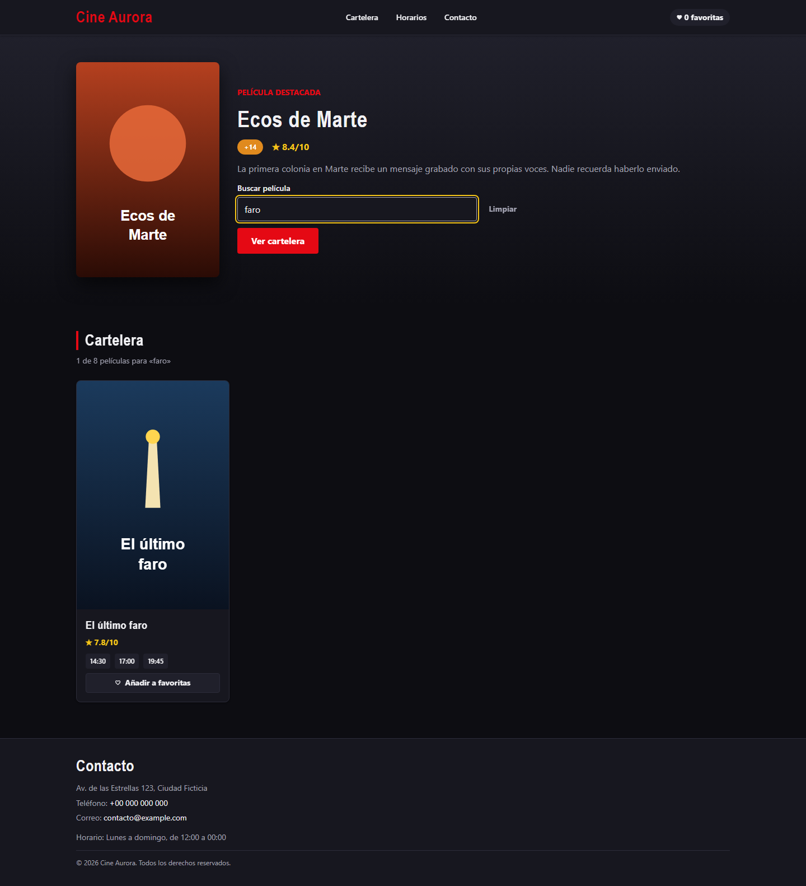

### Resultados

| Comando | Resultado |
|---------|-----------|
| `npm test` | 8 archivos, 40 pruebas superadas (37 anteriores − 2 de `useDebouncedValue` + 5 de `useDebounce`) |
| `npm run lint` | Sin errores ni avisos |
| `npm run build` | Correcto: 41 módulos, JS 242.68 kB (77.01 kB gzip), el mismo tamaño que en el paso 4 |

## Paso 6: Hook propio `useWindowSize` para las tarjetas por fila

### El código del hook

`frontend/src/hooks/useWindowSize.js`:

```js
export const RESIZE_DELAY_MS = 150

function readWindowSize() {
  return { width: window.innerWidth, height: window.innerHeight }
}

export function useWindowSize() {
  const [size, setSize] = useState(readWindowSize)                 // 1

  useEffect(() => {                                                 // 2
    function handleResize() {                                       // 3
      const next = readWindowSize()
      setSize((current) =>                                          // 4
        current.width === next.width && current.height === next.height ? current : next,
      )
    }

    window.addEventListener('resize', handleResize)                 // 5
    return () => window.removeEventListener('resize', handleResize) // 6
  }, [])                                                            // 7

  return useDebounce(size, RESIZE_DELAY_MS)                         // 8
}
```

1. **Estado inicial perezoso:** `useState(readWindowSize)` recibe la función, no su resultado.
   Así el tamaño se lee una sola vez, en el primer render, y el hook devuelve el tamaño real desde
   el principio.
2. **Suscribirse a `window` es un efecto secundario**, así que va en `useEffect` y no en el cuerpo
   del componente, que debe ser puro.
3. **El manejador** se define dentro del efecto, así que es la misma función al añadirla y al
   quitarla.
4. **La actualización** devuelve el mismo objeto si el tamaño no cambió. React ve el mismo valor y
   se salta el render; pasa, por ejemplo, con eventos `resize` que solo cambian el zoom.
5. **Se suscribe** una sola vez, al montar.
6. **La limpieza** quita **la misma** función. Sin esto, cada montaje dejaría un listener vivo que
   intentaría actualizar un componente desmontado.
7. **Dependencias vacías:** el efecto no lee nada de las props ni del estado, así que se ejecuta
   solo al montar, y la limpieza solo al desmontar.
8. **Devuelve el tamaño a través de `useDebounce`** (paso 5).

Respeta las reglas de los hooks: `useState`, `useEffect` y `useDebounce` se llaman siempre, en el
mismo orden y en el nivel superior. `npm run lint` no da avisos.

### Por qué usa `useDebounce` por dentro

Arrastrar el borde de la ventana dispara decenas de eventos `resize` por segundo, uno por cada
pocos píxeles. Las columnas solo cambian al cruzar 600, 900 o 1200 px, así que no tiene sentido
recalcular la rejilla en cada uno.

- **El hook no reinventa el retardo:** reutiliza `useDebounce`. Así el mismo hook sirve para el
  texto del buscador y para el tamaño de la ventana, porque es genérico.
- **150 ms en lugar de 300:** el redimensionado debe sentirse rápido, y el buscador necesita más
  margen entre teclas.
- **Lo que se retrasa es el valor devuelto.** El estado interno sí cambia en cada evento, así que
  `MovieList` hace un render ligero por evento. Pero el tamaño que devuelve el hook, y por tanto
  `columns` y la rejilla, cambia **una sola vez** cuando el usuario suelta el borde. Lo comprueba
  la prueba de la ráfaga.

### Función pura `columnsForWidth` y uso en `MovieList`

`frontend/src/utils/columnsForWidth.js` decide las columnas solo a partir del ancho. No toca el DOM
ni el estado, así que se prueba con una tabla de valores. Ante un ancho inválido (`0`, negativo,
`NaN`) devuelve 1 columna.

| Ancho de la ventana | Columnas |
|---------------------|----------|
| menos de 600 px | 1 |
| de 600 a 899 px | 2 |
| de 900 a 1199 px | 3 |
| 1200 px o más | 4 |

En `MovieList`:

```jsx
const { width } = useWindowSize()
const columns = columnsForWidth(width)
// ...
<div className="grid movie-list__grid" style={{ '--columns': columns }} data-columns={columns}>
```

- **La rejilla es la utilidad `.grid` del paso 2:**
  `grid-template-columns: repeat(var(--columns, 1), minmax(var(--grid-min-column), 1fr))`, con el
  hueco `--grid-gap`.
- **Se quitó el `auto-fill`** de `MovieList.css`: el número de columnas ya no lo decide el
  navegador, sino `columnsForWidth`.
- **`data-columns`** deja el valor a la vista en las herramientas de desarrollo y en las pruebas.
- **`App` no cambia:** la maquetación es asunto de `MovieList`, que obtiene las columnas de su
  propio hook. `columns` no se guarda en estado: se calcula a partir de `width`.

**Cambio visible respecto al `auto-fill`:** antes, a 1024 px salían 4 columnas y a 768 px salían 3,
porque el navegador metía tantas columnas de 224 px como cupieran. Ahora salen 3 y 2, como indica
la tabla. A 1440 px y en móvil no cambia nada.

### Hook → dónde se usa

| Hook | Dónde se usa | Para qué |
|------|--------------|----------|
| `useDebounce` | `App` (buscador) | Aplica el texto de búsqueda 300 ms después de la última tecla |
| `useDebounce` | `useWindowSize` | Entrega el tamaño de la ventana 150 ms después del último `resize` |
| `useWindowSize` | `MovieList` | Calcula `--columns` con `columnsForWidth` |

`useDebounce` se reutiliza así en dos sitios distintos, con dos tipos de valor (texto y objeto) y
dos retardos.

### Pruebas

| Archivo | Pruebas |
|---------|---------|
| `useWindowSize.test.js` (4) | Devuelve el tamaño actual al momento; con temporizadores falsos, el tamaño nuevo llega a los 150 ms y no antes; un arrastre de 5 eventos produce una sola actualización (se registran los anchos devueltos: `[1440, 900]`); al desmontar quita **el mismo** listener que añadió y un `resize` posterior no programa nada |
| `columnsForWidth.test.js` (12) | Tabla de anchos con los bordes de cada tramo (599/600, 899/900, 1199/1200) y anchos inválidos |
| `MovieList.test.jsx` (2, nuevo) | A 1440 px la rejilla tiene la clase `grid` y `--columns: 4`; al cambiar a 390 px y pasar el retardo, pasa a `--columns: 1` |

### Evidencias

Capturas de la parte visible, desplazada hasta la cartelera, en cuatro anchos. En cada una, el
script escribió en la consola el valor real de la rejilla, y las columnas que calcula el navegador
coinciden con `--columns`:

```
CHECK innerWidth=1440 --columns=4 tracks=4
CHECK innerWidth=1024 --columns=3 tracks=3
CHECK innerWidth=768  --columns=2 tracks=2
CHECK innerWidth=390  --columns=1 tracks=1
```

| Evidencia | Explicación |
|-----------|-------------|
| [13_paso6_1440px_4columnas.png](../../Evidencias_lab11/13_paso6_1440px_4columnas.png) | 1440x900: 4 tarjetas por fila |
| [14_paso6_1024px_3columnas.png](../../Evidencias_lab11/14_paso6_1024px_3columnas.png) | 1024x768: 3 tarjetas por fila (antes, con `auto-fill`, eran 4) |
| [15_paso6_768px_2columnas.png](../../Evidencias_lab11/15_paso6_768px_2columnas.png) | 768x1024 (tableta vertical): 2 tarjetas por fila (antes eran 3) |
| [16_paso6_390px_1columna.png](../../Evidencias_lab11/16_paso6_390px_1columna.png) | 390x844 (móvil): 1 tarjeta por fila, cabecera compacta |
| [17_paso6_tests.txt](../../Evidencias_lab11/17_paso6_tests.txt) | Salida detallada de las pruebas: 11 archivos y 58 pruebas superadas |


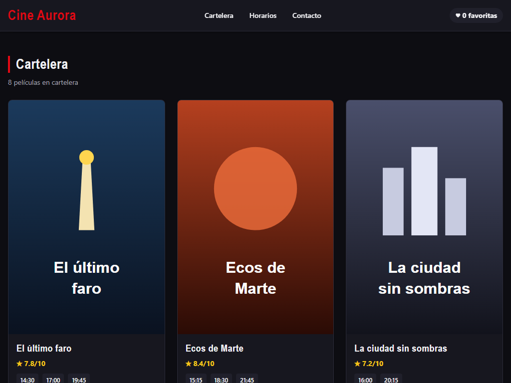
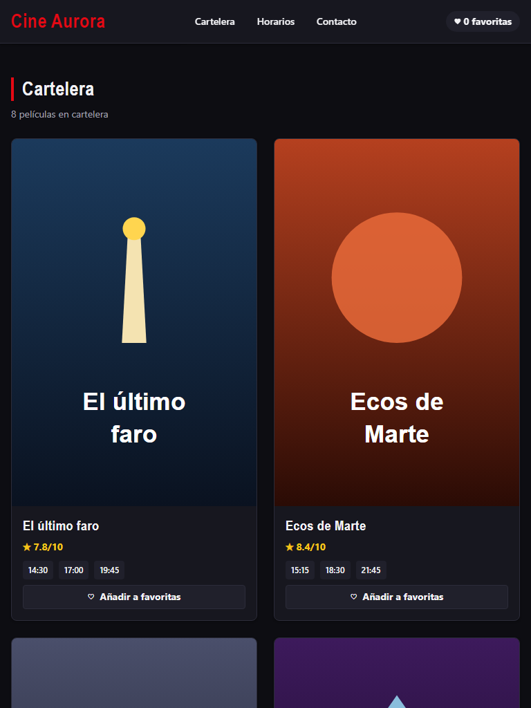
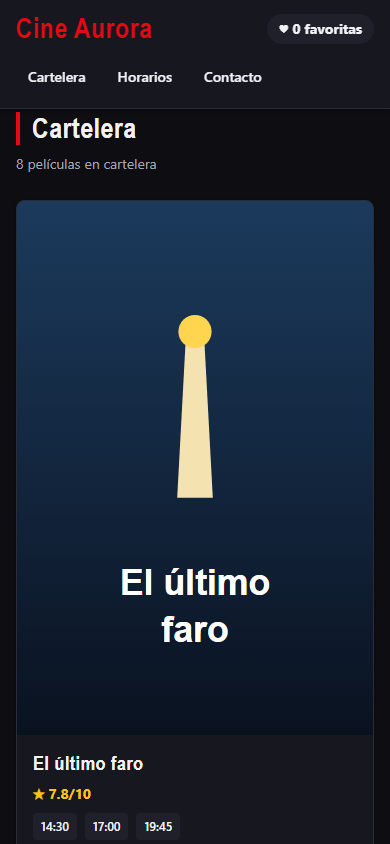

### Resultados

| Comando | Resultado |
|---------|-----------|
| `npm test` | 11 archivos, 58 pruebas superadas (40 anteriores + 18 nuevas) |
| `npm run lint` | Sin errores ni avisos |
| `npm run build` | Correcto: 43 módulos, JS 243.26 kB (77.22 kB gzip), CSS 10.96 kB |

## Paso 7: Hook `usePremieres` con estados de carga, datos y error

Este paso prepara los datos de los estrenos. Todavía no muestra nada en pantalla: eso llega en el
paso 8.

### Piezas nuevas

| Archivo | Qué es |
|---------|--------|
| `src/data/premieres.js` | 6 estrenos ficticios en el **mismo formato de API** del paso 3 (`poster_url`, `overview`, `certification`, `vote_average`, `show_times`) más `release_date` (`YYYY-MM-DD`). Los `id` empiezan en 101 para no chocar con los de la cartelera, porque las favoritas se guardan por `id`. `vote_average` es 0 porque aún no se han estrenado. |
| `public/posters/*.svg` | 6 pósters nuevos (`marea-de-neon`, `el-ultimo-tren-a-orion`, `la-biblioteca-sumergida`, `cometa-de-papel`, `bajo-la-luna-roja`, `las-dunas-que-hablan`) con el estilo de los existentes: 300x450, degradado vertical, una figura sencilla y el título en dos líneas |
| `src/services/premieresService.js` | `fetchPremieres({ delayMs, shouldFail })`: simula la petición al servidor |
| `src/hooks/usePremieres.js` | El hook: pide los datos, los adapta y expone el estado |
| `src/utils/adaptMovie.js` | Ampliado con `release_date` → `releaseDate` |

### Los 3 estados

| `status` | Cuándo | `premieres` | `error` |
|----------|--------|-------------|---------|
| `'loading'` | Al montar, y al pulsar reintentar (`retry`) | `[]` | `null` |
| `'success'` | La petición respondió con datos | Los 6 estrenos, **ya adaptados** al modelo de la app | `null` |
| `'error'` | La petición falló | `[]` | El mensaje para el usuario: «No se pudo conectar con el servidor de estrenos» |

Los tres valores viven en **un solo objeto de estado**, así que cambian juntos y nunca puede
quedar, por ejemplo, `status: 'success'` con un `error` del intento anterior. El hook devuelve
además `retry`.

### El servicio

```js
export function fetchPremieres({ delayMs = DEFAULT_DELAY_MS, shouldFail = false } = {}) {
  return new Promise((resolve, reject) => {
    setTimeout(() => {
      if (shouldFail) reject(new Error(PREMIERES_ERROR_MESSAGE))
      else resolve(structuredClone(apiPremieres))
    }, delayMs)
  })
}
```

Devuelve una `Promise`, como haría `fetch`. Tras el retardo (1,2 s por defecto), rechaza con un
`Error` de mensaje claro o resuelve con los datos **en formato de API**. Adaptarlos no es tarea
del servicio. Cada respuesta es una copia (`structuredClone`), como si llegara por la red, para
que nadie pueda modificar los datos de origen.

### El código del hook explicado

```js
const LOADING = { status: 'loading', premieres: [], error: null }

export function usePremieres({ delayMs, shouldFail } = simulationFromUrl()) {   // 1
  const [request, setRequest] = useState(LOADING)                              // 2
  const [attempt, setAttempt] = useState(0)                                    // 3

  useEffect(() => {
    let ignore = false                                                         // 4

    fetchPremieres({ delayMs, shouldFail }).then(                              // 5
      (data) => {
        if (!ignore) setRequest({ status: 'success', premieres: adaptMovies(data), error: null })
      },
      (error) => {
        const message = error?.message || PREMIERES_ERROR_MESSAGE
        if (!ignore) setRequest({ status: 'error', premieres: [], error: message })
      },
    )

    return () => { ignore = true }                                             // 6
  }, [delayMs, shouldFail, attempt])                                           // 7

  function retry() {                                                           // 8
    setRequest(LOADING)
    setAttempt((current) => current + 1)
  }

  return { ...request, retry }                                                 // 9
}
```

1. **Opciones:** el hook las recibe y, si no se le pasan, usa la simulación leída de la URL (ver
   más abajo). Se desestructuran en valores simples (`delayMs`, `shouldFail`) para que las
   dependencias del efecto no cambien en cada render, como pasaría con un objeto nuevo.
2. **Estado de la petición:** un solo objeto que empieza en `loading`.
3. **`attempt`** es un contador. Cambiarlo es la forma de pedir al efecto que repita la petición.
4. **La bandera de cancelación** de esta petición en concreto (ver el apartado siguiente).
5. **La petición** es asíncrona. Cuando responde, los datos pasan por `adaptMovies`, el mismo
   adaptador de la cartelera: el componente recibirá `image`, `synopsis` y `releaseDate`, nunca
   `poster_url` ni `release_date`. Si el error no trae mensaje, se usa uno claro.
6. **La limpieza** marca la petición como obsoleta.
7. **Dependencias:** se pide de nuevo si cambian las opciones o al reintentar.
8. **`retry`** es un manejador de eventos, no un efecto. Vuelve a `loading` enseguida, con lo que
   la interfaz responde al clic sin esperar, y sube `attempt` para que el efecto repita la
   petición. Poner `setRequest(LOADING)` dentro del efecto sería una actualización síncrona en un
   efecto, que React desaconseja porque provoca un render extra.
9. **Devuelve** el estado y `retry`.

**Reglas de los hooks:**
- `useState` (dos veces) y `useEffect` se llaman siempre, en el mismo orden y en el nivel
  superior.
- Las llamadas a `setRequest` están en las funciones de la promesa y en `retry`, no en el cuerpo
  del componente.
- `npm run lint` (`eslint-plugin-react-hooks` 7) no da avisos.

### Por qué hace falta la bandera de cancelación

Una petición no se puede «deshacer»: el `setTimeout` (o un `fetch` real) responde aunque ya no
interese. Sin la bandera, esa respuesta tardía actualizaría el estado igualmente. Pasa en dos
casos:

1. **Una petición vieja que llega tarde.** Si se reintenta o cambian las opciones mientras hay
   una petición en curso, quedan dos peticiones vivas y pueden responder **en cualquier orden**.
   Si la vieja llega última, pisaría los datos buenos de la nueva con datos o errores antiguos.
   Al cambiar las dependencias, la limpieza del efecto anterior pone su `ignore = true`, así que
   solo cuenta la respuesta de la petición más reciente.
2. **El componente se desmontó.** La respuesta llega cuando ya no hay nada que actualizar. Desde
   React 18 esto no da error, pero sería trabajo inútil: adaptar datos para un componente que ya
   no existe.

Las dos pruebas que lo comprueban se verificaron quitando las comprobaciones `if (!ignore)`:
**fallan sin la bandera y pasan con ella**. Una primera versión de la prueba del desmontaje
pasaba siempre, porque React 18 ignora esas actualizaciones sin avisar. Se reescribió para
comprobar que la respuesta tardía no llega a adaptarse.

### Modo de simulación (solo en desarrollo)

Los estados de carga y error duran poco o no ocurren nunca con datos locales. Para poder verlos y
capturarlos, la URL los fuerza:

| URL | Efecto en desarrollo |
|-----|----------------------|
| `http://localhost:5173/` | Carga normal de unos 1,2 s y luego datos |
| `http://localhost:5173/?estrenos=lento` | La carga dura 4 s |
| `http://localhost:5173/?estrenos=error` | La petición falla. Reintentar vuelve a fallar, como un servidor caído |

```js
export function readSimulation(search, isDev) {
  if (!isDev) return {}
  const mode = new URLSearchParams(search).get('estrenos')
  if (mode === 'error') return { shouldFail: true }
  if (mode === 'lento') return { delayMs: SLOW_DELAY_MS }
  return {}
}

export function simulationFromUrl() {
  return import.meta.env.DEV ? readSimulation(window.location.search, true) : {}
}
```

- **`readSimulation`** es una función pura: recibe la URL y el modo. Así se prueba con cualquier
  combinación, incluida «producción».
- **`simulationFromUrl`** la conecta con la página. Un valor desconocido (`?estrenos=otro`) se
  ignora.

### Por qué no afecta a producción

- **Vite sustituye `import.meta.env.DEV` por una constante** al compilar: `true` con
  `npm run dev` y `false` con `npm run build`. En producción la expresión queda como
  `false ? readSimulation(...) : {}`. El minificador la reduce a `{}` y elimina `readSimulation`,
  porque nada más la usa. Aunque alguien escriba `?estrenos=error` en la web publicada, la
  petición es la normal.
- **Se comprobó en un build real.** El build actual todavía no incluye los estrenos, porque nada
  los usa hasta el paso 8 y el empaquetador los descarta. Por eso se hizo un build temporal que
  sí llama a `fetchPremieres(simulationFromUrl())`, y después se restauró `main.jsx`:

  | Texto buscado en el JS de producción | Apariciones |
  |--------------------------------------|-------------|
  | `servidor de estrenos` (el mensaje de error real) | 1 |
  | `Marea de ne` (datos de los estrenos) | 1 |
  | `URLSearchParams` (lectura de la URL) | **0** |
  | `lento` (modo de simulación) | **0** |

  El servicio y los datos están, pero el código de simulación no existe en producción.
- **No hace falta código de producción especial para las capturas:** la simulación vive en el
  servicio, detrás de `import.meta.env.DEV`, y los componentes no la conocen. Cumple la regla de
  `CLAUDE.md` de forzar estados solo para las capturas sin ensuciar la producción.

### El adaptador ampliado

`release_date` → `releaseDate`. Solo se aceptan fechas reales en formato `YYYY-MM-DD`: no valen
`2026-02-30`, `04/12/2026` ni `2026-12-4`. La fecha se guarda como texto ISO y se formateará en la
interfaz del paso 8.

Para **no romper la cartelera**, `releaseDate` solo se añade al modelo si la API envía una fecha
válida. Las películas de la cartelera no tienen fecha, así que su modelo sigue siendo exactamente
`{ id, title, image, synopsis, classification, rating, showtimes }`. La prueba del paso 3 que
compara las 8 películas campo a campo, y la que comprueba que el modelo tiene solo esos 7 campos,
siguen pasando sin tocarlas.

### Pruebas

| Archivo | Pruebas nuevas |
|---------|----------------|
| `usePremieres.test.js` (7) | Con temporizadores falsos: empieza en `loading`; pasa a `success` a los 1200 ms (no a los 1199) con los datos adaptados (`releaseDate`, sin `release_date`); pasa a `error` con el mensaje; `retry` vuelve a `loading` y luego a `success` (el servicio se simula para fallar solo la primera vez); mensaje claro si el error no trae uno; no procesa la respuesta tras desmontar; una respuesta vieja y lenta no pisa a una nueva |
| `premieresService.test.js` (8) | Resuelve con los datos de API tras 1200 ms; devuelve una copia; rechaza con el mensaje en español; `?estrenos=error` y `?estrenos=lento` en desarrollo; sin parámetro o con un valor desconocido no cambia nada; **fuera de desarrollo se ignora**; `simulationFromUrl` lee la URL real |
| `adaptMovie.test.js` (+4) | `release_date` → `releaseDate`; sin fecha no aparece el campo (la cartelera no cambia); fechas inválidas descartadas; los 6 estrenos se adaptan con su fecha y su póster |

### Evidencias

| Evidencia | Explicación |
|-----------|-------------|
| [18_paso7_tests.txt](../../Evidencias_lab11/18_paso7_tests.txt) | Salida detallada de las pruebas: 13 archivos y 77 pruebas superadas, 19 de ellas nuevas en este paso |

### Resultados

| Comando | Resultado |
|---------|-----------|
| `npm test` | 13 archivos, 77 pruebas superadas (58 anteriores + 19 nuevas) |
| `npm run lint` | Sin errores ni avisos |
| `npm run build` | Correcto: 43 módulos, JS 243.49 kB (77.34 kB gzip). Los estrenos aún no se usan en pantalla, así que todavía no entran en el bundle |

## Paso 8: Esqueleto de carga y carrusel de estrenos con Swiper

### Qué se construyó

```
App
├─ Hero
├─ PremieresSection        ← usePremieres() (estado de la petición)
│   ├─ loading → SkeletonCard ×4 (+ texto «Cargando estrenos…» para lectores)
│   ├─ error   → mensaje role="alert" + Button «Reintentar» → retry()
│   └─ success → PremiereCarousel premieres={…}   ← useWindowSize() → diapositivas por vista
└─ MovieList
```

Además, `Header` tiene un enlace nuevo, «Estrenos» (`#estrenos`). Se añadió como primer elemento
de `cinema.navLinks` en `data/movies.js`, porque la sección va antes que la cartelera. El
componente `Header` no cambió.

### La biblioteca integrada: Swiper

Se usa **Swiper 14** (instalado en el paso 1) con su paquete para React:

```js
import { A11y, Keyboard, Navigation, Pagination } from 'swiper/modules'
import { Swiper, SwiperSlide } from 'swiper/react'
import 'swiper/css'
import 'swiper/css/a11y'
import 'swiper/css/navigation'
import 'swiper/css/pagination'
```

- **`Swiper` y `SwiperSlide`:** el contenedor y cada diapositiva.
- **Módulos:** Swiper solo incluye lo que se le pide.
  - `Navigation` pone las flechas.
  - `Pagination` pone los puntos; con `clickable` se puede pulsar cada uno.
  - `Keyboard` permite moverse con las flechas del teclado.
  - `A11y` pone los textos para lectores de pantalla.
- **CSS:** cada módulo trae su hoja de estilos y se importa la de cada uno que se usa.
- **Colores y tamaños:** Swiper lee variables CSS (`--swiper-theme-color`,
  `--swiper-navigation-color`, `--swiper-pagination-color`, …). `PremiereCarousel.css` les asigna
  los tokens del paso 2, así que la biblioteca usa la paleta del cine sin colores escritos a mano.
- **Textos en español:** van en la opción `a11y`.

Comprobado en el navegador:

```
CHECK bullets=Ir al estreno 1 | Ir al estreno 2 | Ir al estreno 3
CHECK region=carrusel / slide1=1 de 6 / index=0
CHECK tras ArrowRight index=1
```

Las flechas se anuncian como «Estreno anterior» y «Estreno siguiente»; lo comprueba también una
prueba. Cada diapositiva se anuncia como «1 de 6», y la tecla → avanza una diapositiva.

**Coste en tamaño:** Swiper y sus estilos llevan el JS de 243 a 350 kB (de 77 a 109 kB comprimido)
y el CSS de 11 a 28 kB. Es el precio de un carrusel accesible, con gestos táctiles y teclado,
sin escribirlo a mano.

### `Skeleton` y `SkeletonCard`

```jsx
function Skeleton({ width, height, className = '' }) {
  return (
    <span className={`skeleton ${className}`.trim()} style={{ width, height }} aria-hidden="true" />
  )
}

function SkeletonCard() {
  return (
    <div className="skeleton-card" aria-hidden="true">
      <Skeleton className="skeleton-card__poster" />
      <div className="skeleton-card__body">
        <Skeleton className="skeleton-text" width="75%" />
        <Skeleton className="skeleton-text" width="45%" />
      </div>
    </div>
  )
}
```

- **`Skeleton`** es el bloque básico y se puede reutilizar:
  - Usa la utilidad `.skeleton` del paso 2: los tokens `--skeleton-*`, la animación `shimmer`, y
    sin animación con `prefers-reduced-motion`.
  - El tamaño llega por props, así sirve para líneas, avatares o bloques.
- **`SkeletonCard`** compone tres `Skeleton` con la forma de una tarjeta. El póster tiene la misma
  proporción 2:3 que los reales, así que la página no salta cuando llegan los datos.
- **Son decorativos (`aria-hidden="true"`).** Un lector de pantalla no debe leer bloques grises.
  Lo que oye es el texto que pone quien los usa («Cargando estrenos…»).
- **Están en la misma carpeta** (`components/Skeleton/`): son el componente y su variante, y
  comparten `Skeleton.css`.

### `PremiereCarousel`

```jsx
function PremiereCarousel({ premieres }) {
  const { width } = useWindowSize()
  const slidesPerView = columnsForWidth(width)

  return (
    <Swiper modules={[Navigation, Pagination, Keyboard, A11y]} slidesPerView={slidesPerView}
            spaceBetween={24} navigation pagination={{ clickable: true }}
            keyboard={{ enabled: true }} a11y={A11Y_TEXTS} watchOverflow>
      {premieres.map(({ id, title, image, releaseDate }) => (
        <SwiperSlide key={id}>
          
          <h3>{title}</h3>
          <p>Estreno: <time dateTime={releaseDate}>{formatReleaseDate(releaseDate)}</time></p>
        </SwiperSlide>
      ))}
    </Swiper>
  )
}
```

- **Es de presentación:** recibe `premieres` ya adaptados (`image`, `releaseDate`) y no sabe de
  dónde vienen ni si hubo error.
- **Diapositivas por vista:** con `useWindowSize` + `columnsForWidth`, las **mismas** reglas que
  la cartelera: 1, 2, 3 o 4 según el ancho. Así `useWindowSize` se reutiliza en `MovieList` y en
  el carrusel. Cuando cambia el ancho, Swiper recibe el nuevo `slidesPerView` y se recoloca.
- **`watchOverflow`** oculta las flechas y los puntos si caben todas las diapositivas.
- **La fecha** pasa por `formatReleaseDate` (`utils/`), que usa `Intl.DateTimeFormat('es')` en
  UTC: `2026-12-18` → «18 de diciembre», sin que el día cambie por la zona horaria. Va en un
  `<time dateTime="2026-12-18">`, así que la máquina lee la fecha ISO y la persona, el texto.
- **Las diapositivas son `<div>`, no `<article>`.** Las pruebas de `App` cuentan los `article`
  para saber cuántas películas de la cartelera se ven, y los estrenos no deben sumarse ahí.

### `PremieresSection`

```jsx
function PremieresSection() {
  const { status, premieres, error, retry } = usePremieres()

  return (
    <section id="estrenos" aria-labelledby="premieres-title" aria-busy={status === 'loading'}>
      <h2 id="premieres-title">Próximos estrenos</h2>

      {status === 'loading' && (<>
        <p className="visually-hidden" role="status">Cargando estrenos…</p>
        <div className="grid premieres__skeletons">{/* 4 × <SkeletonCard /> */}</div>
      </>)}

      {status === 'error' && (
        <div className="premieres__error">
          <div role="alert">
            <p>No pudimos cargar los estrenos</p>
            <p>{error}. Revisa tu conexión e inténtalo de nuevo en unos segundos.</p>
          </div>
          <Button variant="secondary" onClick={retry}>Reintentar</Button>
        </div>
      )}

      {status === 'success' && <PremiereCarousel premieres={premieres} />}
    </section>
  )
}
```

- **Un bloque por estado:** solo se pinta uno, según `status`.
- **Mientras carga:**
  - `aria-busy="true"` avisa a los lectores de que la región se está actualizando.
  - El texto oculto con `role="status"` anuncia «Cargando estrenos…».
  - Se pintan 4 `SkeletonCard`, pero se ve solo la primera fila: el CSS usa los mismos cortes
    que `columnsForWidth` (1 en móvil, 2 en tableta, 4 en escritorio), así que se reserva el mismo
    hueco que ocupará el carrusel.
- **Con error:**
  - El mensaje del hook va dentro de `role="alert"`, que el lector anuncia en cuanto aparece,
    junto con una sugerencia de qué hacer.
  - El botón está **fuera** del `alert`: el aviso lee el mensaje, no «Reintentar».
  - Se reutiliza `Button` del Lab 10, y su `onClick` es directamente `retry` del hook.
- **Con datos:** se monta el carrusel.

### Por qué los estrenos viven en la sección y no en `App`

La regla del laboratorio es que **el estado sube solo hasta el ancestro común que lo necesita**:

- **`favoriteIds` vive en `App`** porque lo usan dos ramas distintas: `Header` (el contador) y
  `MovieCard` (el botón).
- **Los estrenos solo los usa `PremieresSection`** y lo que hay dentro de ella. Ningún otro
  componente necesita saber si están cargando, si fallaron o cuáles son. Su ancestro común es la
  propia sección.

Subirlos a `App` tendría tres costes:
- `App` volvería a dibujarse entera, con la cartelera incluida, cada vez que cambiara el estado de
  la petición.
- Habría que pasar `status`, `premieres`, `error` y `retry` por props sin que `App` los use.
- `App` crecería con lógica que no le corresponde.

Así, `App` solo monta `<PremieresSection />`, sin props, y la sección es autónoma: se puede mover
o quitar sin tocar nada más.

### Estado → qué ve el usuario

Capturas de la parte visible a 1440x900, desplazadas hasta la sección. Los estados de carga y
error se fuerzan con el modo de simulación del paso 7, que solo existe en desarrollo.

| Estado | URL | Qué ve el usuario | Qué oye un lector de pantalla | Captura |
|--------|-----|-------------------|-------------------------------|---------|
| `loading` | `/?estrenos=lento` | Título y 4 tarjetas grises con brillo en movimiento | «Cargando estrenos…»; región ocupada (`aria-busy="true"`) | [19_paso8_cargando.png](../../Evidencias_lab11/19_paso8_cargando.png) |
| `success` | `/` | Carrusel con 4 estrenos a la vista, flecha «siguiente» y 3 puntos; cada uno con póster, título y fecha («27 de noviembre») | «Carrusel de próximos estrenos», «1 de 6», «Estreno siguiente», «Ir al estreno 2» | [20_paso8_carrusel.png](../../Evidencias_lab11/20_paso8_carrusel.png) |
| `error` | `/?estrenos=error` | Recuadro rojo: «No pudimos cargar los estrenos», el mensaje del servidor, la sugerencia y el botón «Reintentar» | El aviso completo, en cuanto aparece (`role="alert"`) | [21_paso8_error.png](../../Evidencias_lab11/21_paso8_error.png) |
| `error` → `loading` | `/?estrenos=error` + clic en «Reintentar» | Vuelven los esqueletos: la petición se repite | «Cargando estrenos…» | [22_paso8_reintentar.png](../../Evidencias_lab11/22_paso8_reintentar.png) |
| `success` en móvil | `/` a 390 px | Una diapositiva por vista, flecha a la derecha y 6 puntos | Igual que en escritorio | [23_paso8_carrusel_movil.png](../../Evidencias_lab11/23_paso8_carrusel_movil.png) |

La captura 22 se ve igual que la 19 a propósito, porque muestra la carga. Para demostrar que viene
de pulsar «Reintentar», el script registró el estado antes y después del clic en
[22_paso8_reintentar_consola.txt](../../Evidencias_lab11/22_paso8_reintentar_consola.txt):

```
CHECK alert=true busy=false skeletons=0     ← antes del clic: error
CHECK alert=false busy=true skeletons=4     ← después del clic: cargando
```

Con `?estrenos=error`, el reintento vuelve a fallar, como un servidor caído. La prueba de
`usePremieres` (paso 7) comprueba el caso en que el reintento sí funciona.

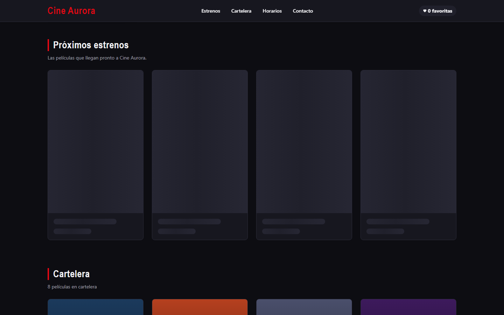
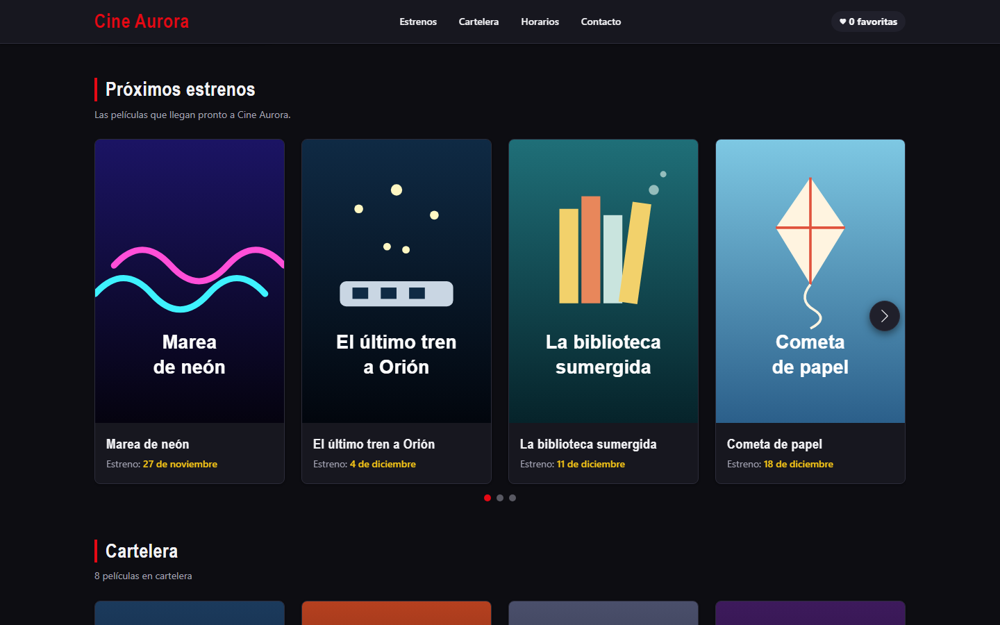
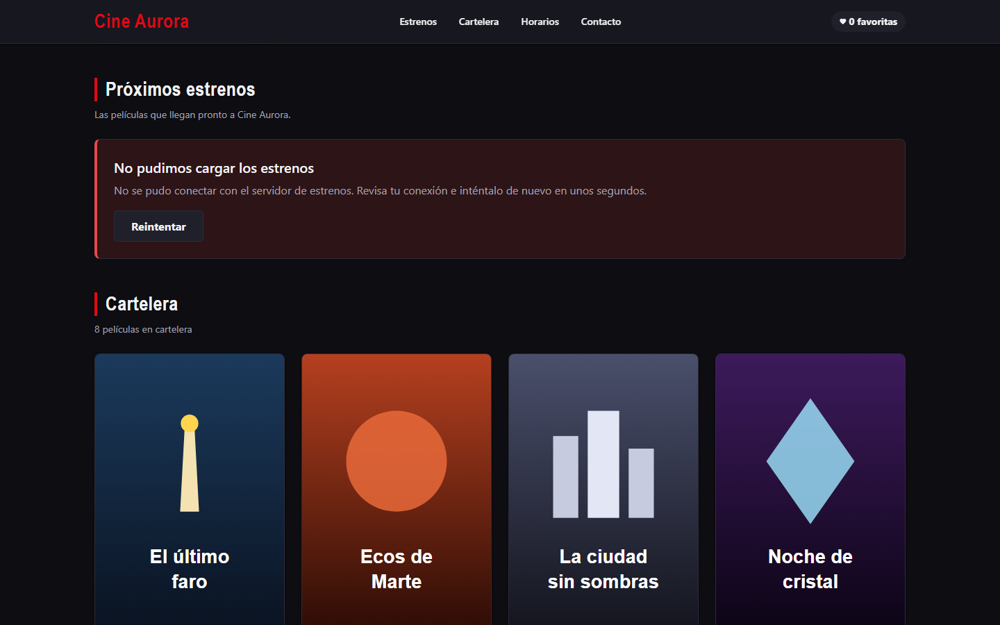
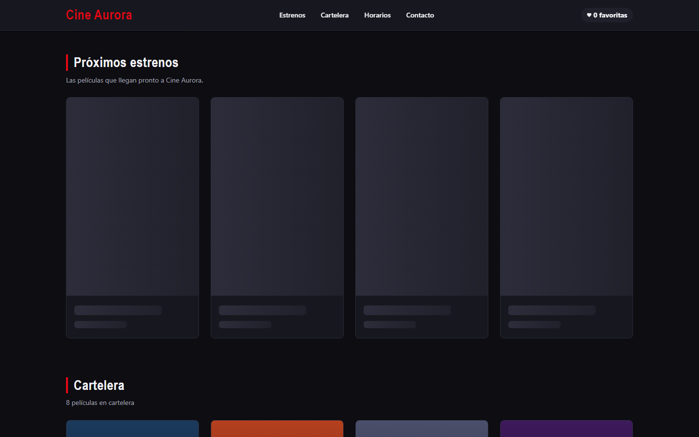
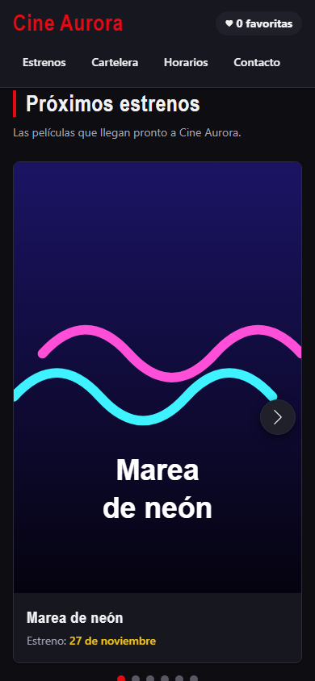

### Hook → dónde se usa (actualizada)

| Hook | Dónde se usa | Para qué |
|------|--------------|----------|
| `useDebounce` | `App` (buscador) | Aplica el texto de búsqueda 300 ms después de la última tecla |
| `useDebounce` | `useWindowSize` | Entrega el tamaño de la ventana 150 ms después del último `resize` |
| `useWindowSize` | `MovieList` | Columnas de la cartelera (`--columns`) |
| `useWindowSize` | `PremiereCarousel` | Diapositivas visibles a la vez (`slidesPerView`) |
| `usePremieres` | `PremieresSection` | Estado de la petición de estrenos: `loading`, `success` o `error`, y `retry` |

### Pruebas

| Archivo | Pruebas |
|---------|---------|
| `PremieresSection.test.jsx` (6, nuevo) | `usePremieres` se sustituye con `vi.mock` para fijar cada estado. **Cargando:** `aria-busy="true"`, `role="status"` con «Cargando estrenos…», 4 `SkeletonCard` con `aria-hidden`, sin alerta ni imágenes. **Error:** `role="alert"` con el título, el mensaje del hook y la sugerencia; `aria-busy="false"`; el botón «Reintentar» llama a `retry` una vez. **Datos:** los 6 títulos como encabezados, sus pósters, la fecha «27 de noviembre» con `datetime="2026-11-27"`, y las flechas de Swiper con `aria-label` en español |
| `formatReleaseDate.test.js` (3, nuevo) | «12 de diciembre», «8 de enero»; primer y último día del mes sin desfase de zona horaria; texto vacío si la fecha falta o no es válida |

### Problemas encontrados al revisar las capturas

- En la primera captura de la carga, los esqueletos salían aplastados a una línea. `grid-auto-rows: 0`
  (pensado para ocultar las filas sobrantes) también se aplicaba a la primera fila, porque no estaba
  declarada. Se corrigió con `grid-template-rows: auto`.
- En móvil asomaba el borde de la segunda tarjeta por debajo de la primera. El hueco inferior era
  un `padding`, que queda **dentro** de la caja recortada. Se cambió por `margin`.

Ambos se vieron solo en las capturas: las pruebas de jsdom no calculan la maquetación.

### Resultados

| Comando | Resultado |
|---------|-----------|
| `npm test` | 15 archivos, 86 pruebas superadas (77 anteriores + 9 nuevas) |
| `npm run lint` | Sin errores ni avisos |
| `npm run build` | Correcto: 93 módulos; JS 350.35 kB (109.49 kB gzip), CSS 27.59 kB (5.09 kB gzip) |

| Evidencia | Explicación |
|-----------|-------------|
| [24_paso8_tests.txt](../../Evidencias_lab11/24_paso8_tests.txt) | Salida detallada de las pruebas: 86 superadas |

## Paso 9: Favoritas en el ancestro común con `useFavorites` y contador en la cabecera

### Qué es elevar el estado

Cuando dos componentes necesitan el mismo dato, ninguno de los dos puede guardarlo: un hermano no
puede leer el estado del otro. La solución es **elevar el estado** (*lifting state up*): se guarda
en el **ancestro común más cercano** y se reparte hacia abajo por props. Los hijos no lo cambian
directamente; avisan al dueño con una función que reciben, y el dueño lo actualiza.

Las favoritas las necesitan dos ramas distintas:
- **`Header`**, para mostrar cuántas hay;
- **`MovieCard`** (dentro de `MovieList`), para pintar cada botón y avisar del clic.

Su ancestro común más cercano es **`App`**, y ahí viven.

### Cómo estaba (comprobación previa)

Antes de cambiar nada se revisó `App.jsx`. `favoriteIds` ya vivía en `App` desde el laboratorio 10,
y `Header` ya recibía solo `favoriteCount={favoriteIds.length}`, un número calculado al pasar las
props, no guardado en estado. El paso no tuvo que mover el estado. Lo que hizo fue:
- **sacar la lógica a un hook propio**, para dejar `App` limpio;
- **hacer accesible el contador**;
- **demostrar con pruebas** que `Header` no recibe la lista.

### Diagrama

```
                         App
        useFavorites() → favoriteIds, favoriteCount, toggleFavorite, isFavorite
        handleToggleFavorite(id) → toggleFavorite(id) + toast()
              │                                   │
   favoriteCount (número)          favoriteIds, onToggleFavorite
              │                                   │
              ▼                                   ▼
           Header                             MovieList
   «♥ 3 favoritas» (aria-live)                    │
                                   isFavorite (booleano), onToggleFavorite
                                                  │
                                                  ▼
                                      MovieCard (×8) ── clic ──▶ onToggleFavorite(id)
                                                                         │
                                       ◀──────── sube hasta App ─────────┘
```

Cada componente recibe **lo mínimo** que necesita:

| Componente | Recibe | No recibe |
|------------|--------|-----------|
| `Header` | `favoriteCount`, un número | La lista: solo la mostraría como un número |
| `MovieList` | `favoriteIds` y `onToggleFavorite` | — (necesita la lista para saber qué tarjetas están marcadas) |
| `MovieCard` | `isFavorite`, un booleano, y `onToggleFavorite` | La lista: solo le importa su propia película |

### Por qué el contador se deriva y no se guarda

`favoriteCount` es siempre `favoriteIds.length`. Si se guardara en otro `useState`:

- **Habría dos fuentes de verdad.** Cada cambio en la lista obligaría a acordarse de actualizar
  también el contador. Basta un olvido (o un error en un caso raro, como dos clics seguidos) para
  que la cabecera diga «3 favoritas» con 2 tarjetas marcadas.
- **Habría un render extra**, para actualizar un número que ya se sabe.
- **No aportaría nada:** calcular `.length` es instantáneo.

Por eso `useFavorites` lo devuelve calculado en cada render. Nunca puede desincronizarse, y la
prueba `derives the count from the list` lo comprueba tras añadir y quitar.

### El código de `useFavorites`

`frontend/src/hooks/useFavorites.js`:

```js
export function useFavorites() {
  const [favoriteIds, setFavoriteIds] = useState(loadFavoriteIds)       // 1

  useEffect(() => {                                                     // 2
    saveFavoriteIds(favoriteIds)
  }, [favoriteIds])

  function toggleFavorite(movieId) {                                    // 3
    setFavoriteIds((currentIds) =>
      currentIds.includes(movieId)
        ? currentIds.filter((id) => id !== movieId)
        : [...currentIds, movieId],
    )
  }

  function isFavorite(movieId) {                                        // 4
    return favoriteIds.includes(movieId)
  }

  return {
    favoriteIds,
    favoriteCount: favoriteIds.length,                                  // 5
    toggleFavorite,
    isFavorite,
  }
}
```

1. **Inicializador perezoso:** se pasa la función `loadFavoriteIds`, no su resultado. React la
   llama solo en el primer render, así que `localStorage` se lee una vez y no en cada render.
   `loadFavoriteIds` (Lab 10) devuelve `[]` si el contenido está dañado o el navegador bloquea el
   almacenamiento.
2. **Persistencia:** escribir en `localStorage` es un efecto secundario, así que va en
   `useEffect` y se ejecuta después de cada cambio de la lista.
3. **`toggleFavorite`** usa la forma funcional de `setFavoriteIds`: calcula la lista nueva a partir
   de la **actual**, no de la del último render. Así, dos llamadas seguidas en el mismo lote
   (añadir y quitar) dan el resultado correcto. Es una función pura, sin efectos secundarios.
4. **`isFavorite`** consulta la lista del render actual.
5. **El contador se deriva** de la lista, no se guarda.

**El hook no es un componente ni guarda el estado «aparte».** Cada componente que lo llama tiene
su propio estado. Lo llama `App`, así que **el estado sigue viviendo en `App`**, el ancestro
común. El hook solo saca la lógica del cuerpo de `App`. Cumple las reglas de los hooks:
`useState` y `useEffect` en el nivel superior y siempre en el mismo orden. `npm run lint` no da
avisos.

La guía pide devolver `{ favoriteIds, favoriteCount, toggleFavorite }`. Se devuelve además
`isFavorite`, porque `App` lo necesita para el aviso (siguiente apartado).

### `App` después del cambio

```js
const { favoriteIds, favoriteCount, toggleFavorite, isFavorite } = useFavorites()

function handleToggleFavorite(movieId) {
  const wasFavorite = isFavorite(movieId)     // antes de actualizar
  const title = movies.find((movie) => movie.id === movieId)?.title ?? 'La película'

  toggleFavorite(movieId)

  // aviso del paso 4: quitada (info) o añadida (éxito)
}
```

- **`App` sigue lanzando el aviso del paso 4.** El hook no sabe nada de `react-hot-toast`: cambia
  el estado y nada más. `App` comprueba si la película **ya era** favorita antes de llamar a
  `toggleFavorite`. La actualización del estado sigue siendo pura y el aviso queda fuera de ella.
- **Lo que sale de `App.jsx`:**
  - el `useState(loadFavoriteIds)`, el `useEffect` de guardado y el cálculo del contador;
  - las importaciones de `useEffect` y de `favoritesStorage`.

### Contador accesible en `Header`

```jsx
const favoriteLabel = `${favoriteCount} ${favoriteCount === 1 ? 'favorita' : 'favoritas'}`
// …
<p className="header__favorites" aria-live="polite" aria-atomic="true">
  <span aria-hidden="true">♥ </span>
  {favoriteLabel}
</p>
```

- **`aria-live="polite"`:** cuando cambia el texto, el lector de pantalla lo anuncia en cuanto el
  usuario hace una pausa, sin interrumpir lo que esté leyendo.
- **`aria-atomic="true"`:** anuncia el texto completo, «3 favoritas», y no solo el número que cambió.
- **El corazón es decorativo** (`aria-hidden`), así que no se lee «corazón negro».
- **Singular y plural:** «1 favorita», «0 favoritas», «2 favoritas».

### Pruebas

| Archivo | Pruebas |
|---------|---------|
| `useFavorites.test.js` (7, nuevo) | Empieza vacío; añade y quita con la misma función; `isFavorite`; **contador derivado** (siempre igual a `favoriteIds.length` tras añadir 3 y quitar 1); dos `toggle` seguidos en el mismo lote dan `[]` (actualizador puro); **persistencia**: cada cambio se guarda (`[4]`, `[4,7]`) y al montar se recupera lo guardado; `localStorage` se lee una sola vez |
| `Header.test.jsx` (5, nuevo) | «0 favoritas», «1 favorita», «2 favoritas»; `aria-live="polite"` y `aria-atomic="true"`; el texto cambia cuando cambia la prop |
| `App.props.test.jsx` (1, nuevo) | Sustituye `Header` por un espía que **registra las props reales** que le pasa `App` y dibuja el `Header` de verdad. Tras marcar 2 películas, las props son exactamente `name`, `navLinks` y `favoriteCount`; no hay `favoriteIds`, y `favoriteCount` es un número que pasó por 0, 1 y 2. Va en un archivo aparte porque `vi.mock` afecta a todo el archivo |
| `App.test.jsx` (+1) | Al marcar 2 películas, la cabecera muestra «1 favorita» y luego «2 favoritas», y las dos tarjetas quedan marcadas |

### Mejora del esqueleto encontrada en las capturas

Al tomar la captura 26, los puntos del carrusel asomaban bajo la cabecera. El carrusel terminó de
cargar **después** de desplazar la página y la empujó hacia abajo. Al medir la altura de la
sección `#estrenos` se vio que el esqueleto del paso 8 era **42 px más bajo** que el carrusel. Había
tres causas:

1. **El margen inferior de los esqueletos colapsaba** a través de la sección y quedaba fuera de
   ella (32 px). Se corrigió con `display: flow-root` en `.premieres`.
2. **Las líneas grises eran más bajas que el texto real.** Ahora miden lo mismo que el título
   (`--font-size-lg` × `--line-height-lg`) y que la fecha. La barra se dibuja solo en la caja de
   contenido (`background-clip: content-box`), así que sigue viéndose fina.
3. **La fecha usa `.text-sm`**, que cambia el tamaño pero conserva la altura de línea de `body`
   (1,6). La línea del esqueleto usa la misma.

| Ancho | Antes: cargando → con datos | Después |
|-------|-----------------------------|---------|
| 1440 px | 622,0 → 664,4 px | 664,4 → 664,4 px |
| 1024 px | — | 725,4 → 725,4 px |
| 768 px | — | 787,4 → 787,4 px |
| 390 px | 748,0 → 790,4 px | 790,4 → 790,4 px |

Ahora la página **no se mueve** cuando llegan los estrenos. Como cambió el aspecto del esqueleto,
se repitieron también las capturas
[19_paso8_cargando.png](../../Evidencias_lab11/19_paso8_cargando.png) y
[22_paso8_reintentar.png](../../Evidencias_lab11/22_paso8_reintentar.png) del paso 8.

### Evidencias

| Evidencia | Explicación |
|-----------|-------------|
| [25_paso9_contador_0.png](../../Evidencias_lab11/25_paso9_contador_0.png) | Cabecera con «♥ 0 favoritas» y las tarjetas de la cartelera sin marcar |
| [26_paso9_contador_3.png](../../Evidencias_lab11/26_paso9_contador_3.png) | Tras marcar *El último faro*, *La ciudad sin sombras* y *Noche de cristal*: la cabecera dice «♥ 3 favoritas» y las tres tarjetas tienen el borde rojo y el botón «En favoritas». *Ecos de Marte*, sin marcar, queda en medio para comparar. Se esperó a que se fueran los avisos para que no taparan las tarjetas |
| [27_paso9_tests.txt](../../Evidencias_lab11/27_paso9_tests.txt) | Salida detallada de las pruebas: 18 archivos y 100 pruebas superadas |

En las dos capturas, el script leyó el contador del DOM:

```
CHECK texto=♥ 0 favoritas aria-live=polite marcadas=0
CHECK texto=♥ 3 favoritas aria-live=polite marcadas=3
```

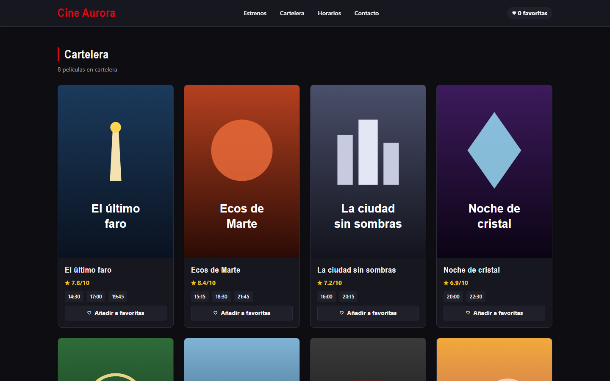
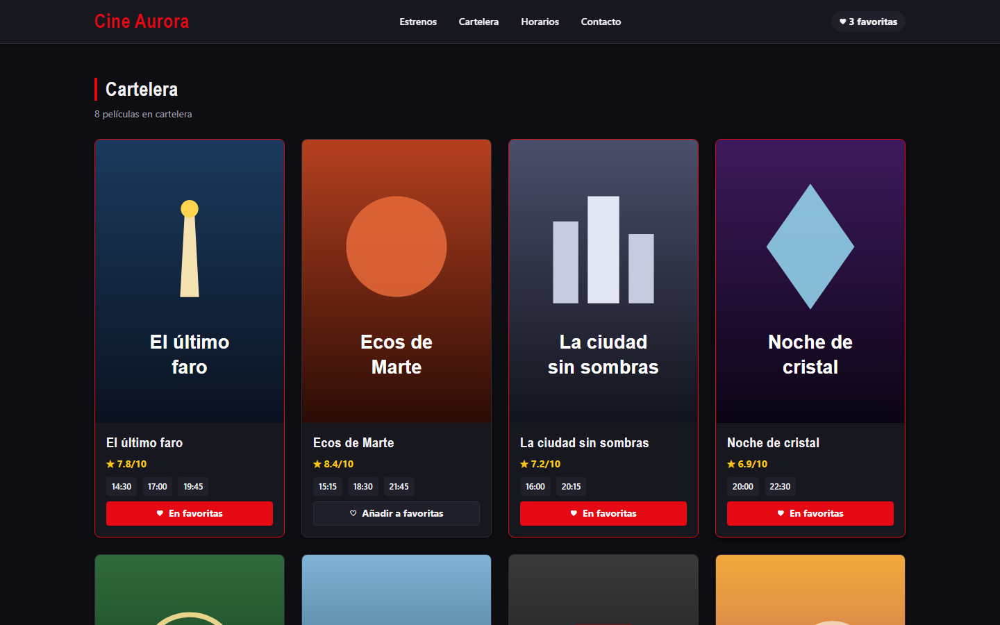

### Resultados

| Comando | Resultado |
|---------|-----------|
| `npm test` | 18 archivos, 100 pruebas superadas (86 anteriores + 14 nuevas) |
| `npm run lint` | Sin errores ni avisos |
| `npm run build` | Correcto: 94 módulos; JS 350.60 kB (109.55 kB gzip), CSS 27.91 kB |

## Paso 10: Botón del banner que limpia el filtro, con buscador y listado sincronizados

### Qué se añadió

En la zona de acciones del banner, junto a «Ver cartelera»:
- **un botón «Quitar filtro»** (`Button` del Lab 10, variante `secondary`), que solo aparece
  mientras la cartelera está filtrada;
- **una línea de estado** «Filtrando por «faro»», con `aria-live="polite"`.

### Cómo se comunican los tres hermanos a través de `App`

```
                                   App
          searchText (estado) ── useDebounce ──▶ searchQuery ──▶ activeFilter
          handleSearchChange(text) → setSearchText(text)
          clearSearch()            → setSearchText('')      ◀── la ÚNICA forma de limpiar
                │                         │                              │
   value, onChange, onClear     children ya armados            query, onClearSearch
                │                         │                              │
                ▼                         ▼                              ▼
          MovieSearch                   Hero                        MovieList
    input controlado              «Ver cartelera»                filtra las tarjetas
    botón «Limpiar» ─┐        «Quitar filtro» ─┐            «Ver toda la cartelera» ─┐
                     │        «Filtrando por…» │            (dentro de EmptyState)   │
                     └──────── clearSearch() ──┴───────────── clearSearch() ─────────┘
                                         │
                                         ▼
                       App: setSearchText('') → nuevo render de los tres
```

- **`MovieSearch`**, **`Hero`** (con su botón) y **`MovieList`** son hermanos: ninguno es padre
  de otro. Ninguno puede leer ni cambiar el estado de los demás.
- **El texto vive en `App`**, su ancestro común. Cada uno recibe lo que necesita: el buscador, el
  valor y las funciones; la cartelera, la consulta ya aplicada; el banner, los hijos ya armados.
- **Los tres caminos para limpiar llaman a la misma función**, `clearSearch`, que hace una sola
  cosa: `setSearchText('')`. Tras ese cambio, React vuelve a dibujar `App` y los tres hermanos
  reciben a la vez el estado nuevo.

### Por qué ninguno guarda su propia copia del texto

Si cada hermano tuviera su `useState` con el texto, habría **tres fuentes de verdad** y habría que
mantenerlas sincronizadas a mano:

- **Si el texto viviera en `MovieSearch`,** el botón del banner y el del estado vacío no podrían
  vaciarlo: no se puede cambiar el estado de otro componente. Habría que añadir efectos que
  copiaran el valor de un lado a otro, con renders de más y momentos en que no coinciden.
- **Si `MovieList` tuviera su copia,** podría mostrar 1 película mientras el buscador ya está
  vacío.
- **Si el banner guardara «hay filtro» en un estado propio,** podría seguir enseñando «Quitar
  filtro» con la cartelera completa.

Con **una sola fuente** (`searchText` en `App`), lo demás se **calcula**:
- `searchQuery`, el texto tras el retardo;
- `activeFilter = searchQuery.trim()`, que decide si se ven el botón y la línea de estado;
- la lista filtrada, que calcula `MovieList`.

Nada se guarda dos veces, así que no hay nada que desincronizar. `MovieSearch` es un **input
controlado**: muestra `value` y avisa con `onChange`, así que al vaciarse `searchText` el campo se
vacía solo.

### El código explicado

`frontend/src/App.jsx`:

```jsx
const searchQuery = searchText === '' ? '' : debouncedText    // 1
const activeFilter = searchQuery.trim()                       // 2

function clearSearch() {                                      // 3
  setSearchText('')
}

<Hero movie={featured}>                                       {/* 4 */}
  <MovieSearch value={searchText} onChange={handleSearchChange} onClear={clearSearch} />
  <div className="cluster">
    <Button href="#cartelera">Ver cartelera</Button>
    {activeFilter && (                                        // 5
      <Button variant="secondary" onClick={clearSearch}>Quitar filtro</Button>
    )}
    <p className="text-sm text-muted" aria-live="polite">     {/* 6 */}
      {activeFilter && `Filtrando por «${activeFilter}»`}
    </p>
  </div>
</Hero>

<MovieList … query={searchQuery} onClearSearch={clearSearch} />
```

1. **Vaciar no espera el retardo** (desde el Lab 10): si `searchText` es `''`, la consulta es `''`
   en ese mismo render. Por eso, al pulsar «Quitar filtro», las 8 películas vuelven **al
   instante**, sin esperar los 300 ms de `useDebounce`.
2. **`activeFilter` se deriva** de la consulta que la cartelera está aplicando, no del texto que
   se escribe. Así, «Filtrando por…» describe siempre lo que se ve. Mientras se escribe (antes de
   los 300 ms) el banner no dice nada todavía; lo comprueba una prueba.
3. **`clearSearch`**, la misma función para los tres caminos.
4. **Patrón `children` del Lab 10:** `App` arma el contenido de las acciones y se lo pasa a `Hero`.
   `Hero` solo hace `{children}`: no conoce el texto, ni el botón, ni `clearSearch`, y no cambió.
5. **El botón aparece solo con un filtro activo.** Su `onClick` es `clearSearch`, la misma
   función, no una copia.
6. **La línea de estado está siempre en el DOM**, vacía si no hay filtro. Una región
   `aria-live` tiene que existir **antes** del cambio para que el lector de pantalla lo anuncie:
   si se creara junto con el texto, muchos lectores no lo leerían. Va dentro de la fila de
   acciones, porque como hijo directo del banner, que usa `gap` en columna, un párrafo vacío
   habría añadido 12 px de alto. Se midió: el banner mide lo mismo que antes del cambio
   (480 px a 1440, 861,5 px a 390).

### Verificación de la sincronización

| Comprobación | Cómo | Resultado |
|--------------|------|-----------|
| Al pulsar «Quitar filtro», el buscador queda vacío, vuelven las 8 películas y el botón desaparece | Prueba de `App` y script en el navegador | Correcto. En el navegador, **50 ms** después del clic (menos que los 300 ms del retardo): `input="" peliculas=8 boton=false` |
| Búsqueda sin resultados limpiada desde el banner | Prueba de `App` con `xyz` | Desaparece el estado vacío y vuelven las 8 |
| «Limpiar» del buscador sigue funcionando | Prueba existente `keeps favorites while the list is being filtered` | Correcto |
| «Ver toda la cartelera» del estado vacío sigue funcionando | Prueba existente `shows the empty state and recovers the list from its button` | Correcto |
| **Los tres usan la misma función** | `App.props.test.jsx` registra las props reales: `onClear` de `MovieSearch`, `onClearSearch` de `MovieList` y `onClick` del botón «Quitar filtro», del mismo render | Son **la misma referencia** (`toBe`) |

La última prueba se verificó a la inversa: al cambiar el `onClick` del banner por una copia
(`() => setSearchText('')`), que se comporta igual, la prueba **falla**. Al restaurar
`clearSearch`, vuelve a pasar. No basta con que el comportamiento coincida: tiene que ser la misma
función.

### Pruebas

| Archivo | Pruebas nuevas |
|---------|----------------|
| `App.test.jsx` (+3) | Escribir «faro» → la cartelera filtra a 1 → el banner muestra «Filtrando por «faro»» (con `aria-live="polite"`) y el botón → «Quitar filtro» → input vacío, «8 películas en cartelera», sin botón, sin línea de estado y sin el «Limpiar» del buscador. Búsqueda `xyz` sin resultados limpiada desde el banner. La línea de estado aparece solo cuando el filtro se aplica, no en cada tecla |
| `App.props.test.jsx` (+1) | Los tres caminos reciben la misma función `clearSearch` |

### Evidencias

| Evidencia | Explicación |
|-----------|-------------|
| [28_paso10_filtro_activo.png](../../Evidencias_lab11/28_paso10_filtro_activo.png) | Página completa con «faro» escrito: el buscador con `faro` y su «Limpiar»; en el banner, «Ver cartelera», **«Quitar filtro»** y «Filtrando por «faro»»; la cartelera, con «1 de 8 películas para «faro»» y solo *El último faro* |
| [29_paso10_filtro_limpio.png](../../Evidencias_lab11/29_paso10_filtro_limpio.png) | Tras pulsar «Quitar filtro»: el buscador vacío (vuelve el texto de ejemplo), en el banner solo «Ver cartelera», y la cartelera con «8 películas en cartelera» y las 8 tarjetas |
| [30_paso10_tests.txt](../../Evidencias_lab11/30_paso10_tests.txt) | Salida detallada de las pruebas: 18 archivos y 104 pruebas superadas |

Estado leído del DOM por el script, antes y 50 ms después del clic:

```
CHECK input="faro" peliculas=1 boton=true  estado="Filtrando por «faro»"
CHECK input=""     peliculas=8 boton=false estado=""
```

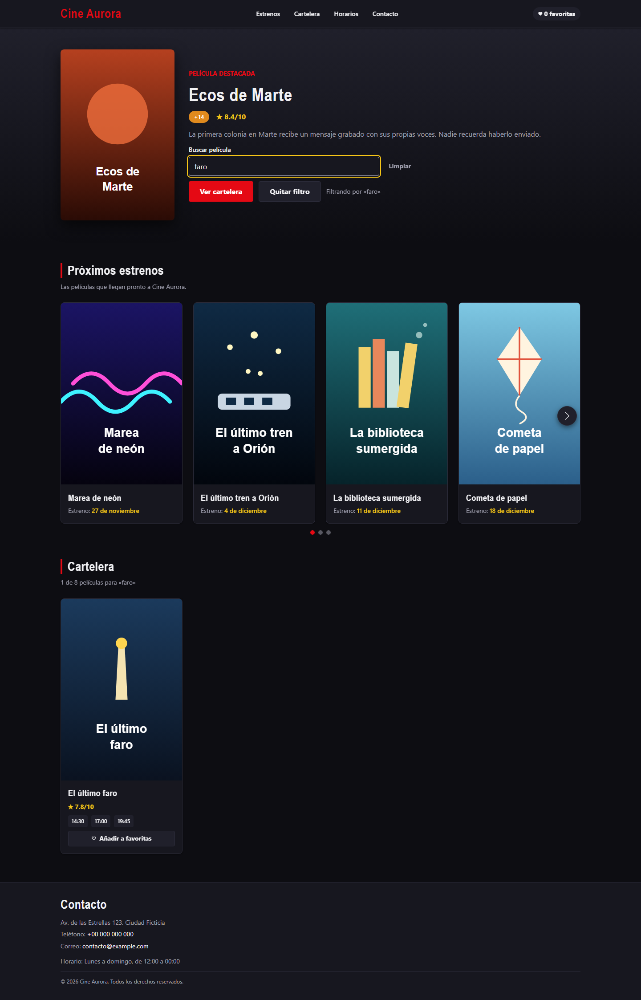
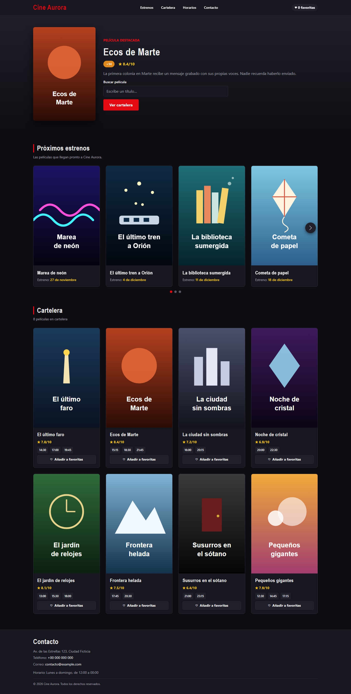

### Resultados

| Comando | Resultado |
|---------|-----------|
| `npm test` | 18 archivos, 104 pruebas superadas (100 anteriores + 4 nuevas) |
| `npm run lint` | Sin errores ni avisos |
| `npm run build` | Correcto: 94 módulos; JS 350.84 kB (109.63 kB gzip) |
